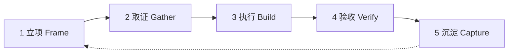

# zstao

**Zhang Shengtao 专用工作流**

把与 AI 协作的方式，沉淀成可执行的资产。

---

## 这是什么

`zstao` 是 Zhang Shengtao 的个人 AI / Agent 工作流仓库，也是这套工作流的**唯一事实源**。

它不收藏资料，只沉淀能直接复用的东西：

| 资产 | 解决的问题 | 位置 |
| --- | --- | --- |
| 工作原则 | 动手之前，用什么标准判断 | [`docs/principles.md`](docs/principles.md) |
| 标准流程 | 一件事从想法到交付怎么走 | [`docs/workflow.md`](docs/workflow.md) |
| 提示词 | 怎么把要求讲清楚，让 AI 一次做对 | [`prompts/`](prompts/README.md) |
| Agent 角色 | 什么时候该拆成多个角色协作 | [`agents/`](agents/README.md) |
| 脚本 | 重复三次以上的动作，交给机器 | [`scripts/`](scripts/README.md) |
| 模板 | 新任务、新决策从哪里开始写 | [`templates/`](templates/README.md) |

## 工作流一览



五个阶段，每一步都有明确的输入、产出和退出条件，详见 [`docs/workflow.md`](docs/workflow.md)。

## 快速开始

```powershell
git clone https://github.com/zmdo/zstao.git
cd zstao

# 新建一个工作项（Windows PowerShell 5.1+ 或 PowerShell 7）
powershell -File scripts/New-WorkItem.ps1 -Title "把子代理评审接进日常流程"
```

## 目录结构

```text
.
├── AGENTS.md     # 给 AI Agent 的仓库级约定
├── README.md
├── docs/         # 原则、流程、提示词写法
├── prompts/      # 可直接复用的提示词
├── agents/       # Agent 角色卡与交接协议
├── scripts/      # 新建工作项的脚本
└── templates/    # 工作项 / 决策模板
```

## 约定

- **语言**：文档用中文；代码与文件名用英文。
- **命名**：目录与文件用 `kebab-case`。
- **隐私**：个人笔记、密钥、客户资料不进仓库，放本地 `inbox/`（已忽略）。

## 与 AI 协作

1. 先读 [`AGENTS.md`](AGENTS.md)，了解在本仓库里协作的基本约定。
2. 再按 [`docs/workflow.md`](docs/workflow.md) 走一遍五个阶段。
3. 提示词从 [`prompts/`](prompts/README.md) 取，不要每次从零写。

## Roadmap

- [x] 仓库骨架、原则与标准流程
- [x] 提示词库与 Agent 角色卡
- [x] 工作项脚本与模板
- [ ] 接入 MCP 工具链清单
- [ ] 季度复盘模板与指标看板

## License

[MIT](LICENSE) © 2026 Zhang Shengtao
