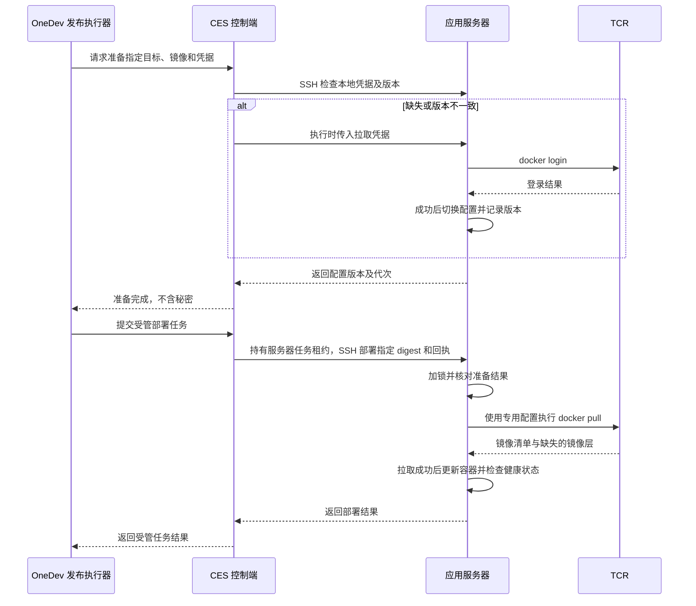

# 应用服务器 TCR 凭据按需注入与更新方案

- 状态：代码已实现，本地验证通过；线上接入与真实 TCR 验收尚未执行。详见[实施记录与接入说明](./implementation.md)。
- 日期：2026-11-09。
- 核对基线：`feat/code-repository`，`911443e`。
- 范围：应用服务器的 Registry 拉取凭据、首次拉取、重复拉取、密码更新、部署衔接及回收。
- 关联方案：[应用服务器类型](../application-server-type/README.md)、[OneDev 流水线展示](../deployment-pipelines/README.md)。

## 1. 方案结论

目标是让应用服务器自动拉取部署所需的私有镜像，减少人工登录和配置。采用专用只读拉取凭据，在受管服务器上持久保存并按版本维护。

1. 选择“应用服务器”类型时准备 Docker Engine、Docker Compose，不立即向所有该类型服务器分发 TCR 凭据。
2. 首次受管拉取前，如果目标服务器没有对应凭据，由 CES 下发并完成登录，然后执行拉取。
3. 后续拉取复用已保存的凭据；凭据存在、版本一致时，不重复登录或写入。
4. 在 CES 更新拉取密码时，产生新的凭据版本，后台同步已经关联的服务器；每次拉取前再核对版本。
5. 离线服务器保留待同步状态；恢复连接或下一次部署时补齐。同步失败不能显示为已同步。
6. OneDev 保留构建和发布编排职责，CES 负责受管服务器的凭据准备，目标服务器上的 Docker 直接从 TCR 下载镜像。
7. 腾讯云 API 密钥、构建推送凭据、应用拉取凭据分开管理。应用服务器只接收它需要的 Registry 拉取凭据。
8. 凭据更新、拉取和清理使用同一服务器互斥机制，带任务身份和版本检查，避免旧任务覆盖新配置。

本文细化并调整旧方案中的凭据部分：注入时机从“选择应用服务器类型时”调整为“首次受管拉取前”；保留应用服务器角色和只读拉取能力。常驻管理 Agent、cloud-init 自动注册和通用 Secret Manager 不属于本次实施范围。

## 2. 实施前基线（911443e）

| 能力 | 当前实现 | 本次处理 |
| --- | --- | --- |
| OneDev 项目、代码和流水线展示 | 已有页面与查询工具 | 保留 |
| TCR 仓库、Tag、镜像地址查询 | 已有 API、页面及只读 AI 工具 | 保留 |
| TCR 配置加密保存 | API 密钥、Registry 用户名和密码已可保存 | 保留已有数据，区分用途和状态 |
| 构建并推送镜像 | `build-image.sh` 推送 TCR，输出 commit、镜像地址和 digest | 保留 |
| 候选部署 | 本机镜像不存在时才执行 pull | 保留，另补真实仓库拉取验收 |
| 正式发布入口 | OneDev 经 SSH 调用目标机 `ces-runtime install --digest` | 保留编排方式，补凭据准备协议 |
| 应用服务器类型 | 声明 Docker、Compose 软件要求 | 修复运行时依赖，复用容器管理能力 |
| 凭据自动注入、版本同步和回收 | 尚未实现 | 按本文新增 |

设计时发现以下边界；本次代码实现及修复情况见实施记录：

- 应用服务器插件没有声明 `containerRuntime` 依赖，注册顺序变化可导致 `definition_reference`。此前隔离验证已复现，应先修复依赖并等待运行时就绪。
- 容器面板、查询、设置及巡检只适用于原“容器服务器”类型。此前隔离注册验证中，该类型有 4 项扩展，应用服务器有 0 项；应共享 Docker 管理能力。
- 镜像仓库的“已配置”和“测试连接”只反映 TCR API 配置与查询能力。对于镜像浏览，这一含义成立；不能据此判断 Docker 登录或目标服务器拉取成功。
- `build` 与 `candidate` 使用同一执行器，候选部署可能复用本地镜像。因此构建、候选部署成功不构成独立目标机已从 TCR 拉取的证明。
- 仓库中存在 `ces-runtime` 的调用入口，已核对并修改仓库中的 `deploy/ces-runtime.sh`；目标服务器实际安装版本仍须在部署时核对。

源码入口：[应用服务器](../../../plugins/application-server/src/index.ts)、[容器扩展](../../../plugins/server-containers/src/index.ts)、[镜像仓库设置与接口](../../../plugins/project-repositories/src/index.ts)、[构建脚本](../../../scripts/build-image.sh)、[候选部署](../../../scripts/deploy-candidate.sh)、[OneDev 构建定义](../../../.onedev-buildspec.yml)。

## 3. 职责和授权范围

| 参与方 | 职责 | 持有的凭据 |
| --- | --- | --- |
| CES 控制端 | 加密保存配置、绑定部署目标、检查版本、排队同步、通过 SSH 配置目标机、记录状态 | 腾讯云 API 密钥、Registry 凭据密文、受管服务器 SSH 凭据 |
| OneDev 构建执行器 | checkout、构建、推送、输出镜像信息 | 构建所需的推送凭据 |
| OneDev 发布执行器 | 请求 CES 准备凭据，随后提交受管部署任务并等待结果 | 受限的 CES 调用凭证 |
| 应用服务器 | 使用拉取凭据下载指定镜像、启动应用和执行健康检查 | 专用 Registry 拉取凭据 |

应用服务器不安装 OneDev Agent，不接收腾讯云 SecretId / SecretKey。镜像数据从 TCR 直接传到应用服务器，CES 和 OneDev 不中转镜像数据。

第一版按单用户平台实现：可以配置一份平台专用的 TCR 拉取凭据，授权一个明确的命名空间或仓库范围。部署目标第一次使用该凭据时建立关联，后续轮换只处理关联服务器。服务器类型本身不授予任意仓库访问权。

只读权限由 TCR 侧的账号策略保证，不能通过“代码只执行 pull”推断账号没有 push 权限。个人版支持限制子账号只能拉取指定仓库，见[腾讯云个人版授权方案](https://cloud.tencent.com/document/product/1141/41409)。现有 Registry 用户名、密码用途未明确时，保留原数据，不能自动认定为可分发的只读凭据。

## 4. 受管拉取的执行流程

### 4.1 OneDev 与 CES 的衔接

增加受认证的“准备 Registry 拉取凭据”操作。以下表格描述协议职责，已实现的具体路由和字段见[实施记录](./implementation.md)：

| 方向 | 内容 |
| --- | --- |
| 请求 | 部署目标标识、完整镜像引用、关联的拉取凭据标识、幂等请求标识 |
| CES 校验 | 调用方允许的目标范围、镜像仓库范围、服务器绑定及配置修订、凭据是否完整 |
| 异步结果 | 准备任务标识、运行状态、可重试的错误分类 |
| 成功结果 | 服务器标识、凭据标识、凭据版本、远端配置代次、服务器配置修订 |

发布执行器使用单独的服务调用凭证，权限限制为准备、部署授权目标及查询自己的任务。这个接口不返回 Registry 密码或密文，不复用浏览器登录 cookie，也不开放任意主机、Shell 命令或凭据读取能力。

OneDev 在部署步骤前请求准备并等待成功，随后提交受管部署任务。CES 在同一服务器队列中，经已有 SSH 通道传递镜像引用和准备回执，直至发布结束。此处较初稿调整为 CES 持有整个部署的任务租约，关闭“准备完成后 OneDev 独立 SSH”之间的服务器配置变更窗口；理由及路由见[实施记录](./implementation.md)。



凭据准备成功不直接等于镜像可拉取。具体仓库的权限、镜像是否存在、目标机网络和平台架构等，仍由本次 pull 验证。

### 4.2 首次拉取

1. OneDev 选择构建产物中的完整 `registry/namespace/repository@sha256:digest`，提交准备请求。
2. CES 建立或复核服务器与拉取凭据的关联，读取当前凭据版本。
3. CES 通过 SSH 检查平台专用配置目录。即使数据库记为已同步，只要远端文件缺失或元数据不符，也进入重新配置。
4. 在服务器互斥锁内，用执行时传入的密码在临时目录完成 `docker login --password-stdin`。
5. 登录成功后，原子切换平台管理的配置目录指针，保存不含秘密的版本元数据，再回写同步结果。
6. OneDev 提交受管部署任务。CES 持有任务租约，目标程序在同一互斥协议下检查预期版本和代次，再执行 pull。
7. 拉取成功后进入容器更新和健康检查；拉取失败不停止旧容器。

登录及拉取命令的形态如下；路径、账号和镜像引用仅用于说明，实际由宿主校验后生成：

```sh
docker --config '<本次临时配置目录>' login \
  '<registry>' --username '<只读账号>' --password-stdin

docker --config '<已核对的平台配置目录>' pull \
  '<registry>/<namespace>/<repository>@sha256:<digest>'
```

Docker 支持用登录凭据访问私有仓库，密码可从标准输入读取，见[登录文档](https://docs.docker.com/reference/cli/docker/login/)。按 digest 拉取用于固定本次发布的镜像版本，见[拉取文档](https://docs.docker.com/reference/cli/docker/image/pull/#pull-an-image-by-digest-immutable-identifier)。

### 4.3 第二次及后续拉取

每次受管拉取前都核对平台凭据版本和远端实际配置：

| 检查结果 | 动作 |
| --- | --- |
| 对应配置存在，凭据标识和版本一致 | 直接拉取，不执行 login，不重写凭据 |
| 本地配置缺失、损坏或属于其他凭据 | 重新配置后拉取 |
| 平台版本高于服务器记录 | 同步当前版本后拉取 |
| 凭据已撤销或关联已删除 | 拒绝准备，不恢复旧配置 |
| 凭据缺少用户名或密码 | 返回待配置，不能用 API 密钥代替 |

这个自动过程只适用于已接入的发布或拉取入口。用户手工 SSH 执行普通 `docker pull` 不会自动调用 CES；指定相同配置目录时可使用已有凭据，但不会自动获知平台的新版本。本次不增加 Shell 拦截或 Docker 命令替换。

## 5. 凭据版本与密码更新

### 5.1 版本含义

拉取凭据具有稳定标识和独立版本。版本是配置修订号，不是密码哈希，也不由密文内容推导。

- Registry、用户名、密码或允许访问的仓库范围发生改变时，增加拉取凭据版本。
- 只修改 TCR API SecretId / SecretKey、页面显示名称或其他无关配置，不增加拉取凭据版本。
- 保存时使用预期版本检查，拒绝迟到的旧表单覆盖新配置。
- 留空保持原密码与明确撤销凭据是两个不同操作。
- Registry 或授权范围改变后，重新核对已有部署关联；不再适用的关联进入阻塞或清理流程，不能静默扩大权限。

### 5.2 从 v1 更新到 v2

这里的“更新密码”指用户将实际可用的新 Registry 密码保存到 CES。本方案不自动修改腾讯云账号密码。

```text
用户在 CES 保存新密码
  → 加密保存并生成 v2
  → 已关联服务器的期望版本变为 v2
  → 在线服务器排队同步
  → 离线服务器保留待同步
  → 每次拉取前再次检查版本
```

同步任务在执行前重新读取当前版本。如果已由 v2 变为 v3，排队的 v2 任务被标记为已取代，重新处理 v3；不继续把 v2 作为当前配置分发。

服务器只有在新凭据登录成功、配置切换完成并核对任务所有权后，才能记录已应用版本。完成回写时，如果平台已经变为更新版本，应保留服务器实际版本，同时继续显示待同步，而不是误报全部完成。

新密码无效时，本次同步失败，不覆盖之前成功的配置；但旧密码可能已在 TCR 被撤销，因此“保留旧配置”不承诺它仍能拉取。

### 5.3 只在腾讯云修改密码

如果用户修改了腾讯云侧的 Registry 密码，却没有更新 CES：

- CES 无法推断新密码，平台版本也不会自动变化。
- 旧密码失效后，后续认证可能失败。
- 系统返回“拉取凭据失效，请更新平台配置”，不重复分发同一份失效密码。

### 5.4 保存与后台同步的恢复

第一版保留现有加密配置文件作为凭据事实来源，通过宿主服务统一写入，使用保存互斥、预期版本校验和原子替换。服务器关联、任务和执行状态使用现有数据库体系。

文件保存和数据库排队不是一个原子事务，必须处理“凭据已保存，进程在排队前退出”的窗口：

- 宿主启动后及运行期间进行版本对账，为不一致的关联补排任务。
- 发布前检查直接读取当前凭据事实，不能只信任缓存的 `desiredRevision`。
- 队列记录仅包含凭据引用和版本，不复制密码。
- 一旦需要多个 CES 写入进程，应先将凭据及版本迁入支持事务和并发控制的统一存储，不能把进程内互斥当作跨进程锁。

## 6. 远端存储和任务恢复

### 6.1 平台专用配置

建议使用如下平台管理的目录结构；最终根路径作为部署配置提供：

```text
/var/lib/ces/docker-config/<credential-id>/
├─ generations/<operation-id>/
│  ├─ config.json
│  └─ metadata.json
└─ current → generations/<operation-id>
```

每个代次的元数据只包含凭据标识、版本、操作标识和配置代次等非敏感信息。登录在新目录完成，成功后在同一文件系统中原子替换 `current` 指针，避免配置文件和版本元数据分别更新造成不一致。

目录由受控部署执行身份持有，权限 `700`；配置和元数据文件权限 `600`。采用现有受限 sudo 发布入口时，可由 root 管理，由部署程序显式指定 `--config`。不得依赖 SSH 用户的默认 `~/.docker`，也不修改其其他仓库凭据。

平台目录使用确定的凭据存储方式，不能继承未知的 credential helper，把密码写到无法随平台目录清理的外部位置。未使用 helper 时，Docker 配置中的认证内容只是编码形式，不是加密，必须按秘密文件管理，见[Docker 凭据存储说明](https://docs.docker.com/reference/cli/docker/login/)。

临时代次失败后清理；成功切换后，在锁内清理已不再使用的旧代次，避免持续留存旧密码。

### 6.2 秘密的传递

宿主只在任务执行阶段解密，通过 SSH 的标准输入传给专用凭据配置动作；远端再将密码交给 Docker 的标准输入。

明文密码和 Docker `auth` 内容均不进入：

- 类型定义、计划快照、普通扩展配置和队列参数；
- Shell 命令参数、构建定义、环境变量和可下载构建产物；
- 任务报告、模型上下文、错误详情和审计日志。

现有远端监督器会把请求整体写入 `request.json`，所以不能把密码直接加入现有配方 `payload`，也不能认为“通过 stdin 传入现有监督器”就不会落盘。需新增执行时秘密输入通道或独立的凭据配置动作，持久日志只保存引用、版本和结果。[现有监督器](../../../plugins/server-management/src/host/remote/supervisor.ts)

### 6.3 重启和连接中断

- 本地数据库未记成功，但远端已完成配置切换：恢复任务核对远端操作标识、配置代次和当前期望版本，再补记结果。
- 远端仍只有临时目录：不能把它视为已配置；清理或在新任务中重新登录。
- 远端结果未知：先查询状态，不能把 SSH 断开直接认定为没有执行。
- 已过期的任务不能回写最新状态，也不能切换远端当前指针。平台任务租约、数据库完成条件和远端操作所有权需要共同校验。
- 插件卸载时先停止接收和排队新任务，等待已接收工作完成或转入可恢复状态，再释放依赖服务。

## 7. 并发、认证失败与网络失败

### 7.1 同一服务器的互斥

凭据同步、受管 pull 和凭据清理接入同一服务器操作锁。部署通过同一 CES 队列持有任务租约，目标部署程序也参加远端互斥协议，以覆盖断线后仍在执行的子进程。

凭据准备与正式部署之间存在时间间隔。部署程序取得锁后核对准备结果的凭据版本、配置代次和服务器配置修订；如果发生变化，返回结构化的“准备结果已过期”，由 OneDev 重新请求准备一次，不能直接使用过期结果。

已经开始的 pull 使用当时核验的配置。云端密码可能在拉取期间被外部撤销，平台无法保证正在进行的请求无感完成；失败后按下面规则恢复。平台保存新版本不会让所有服务器在同一瞬间完成同步。

### 7.2 有界重试

| 失败情况 | 处理 |
| --- | --- |
| 鉴权失败，平台已有新版本 | 同步当前版本后，最多自动重试本次拉取一次 |
| 鉴权失败，本地配置确实缺失或损坏 | 重新配置后，最多自动重试一次 |
| 鉴权失败，平台版本未变且配置完整 | 报告凭据或仓库权限问题，不反复注入相同密码 |
| TCR 密码只在云端更新 | 提示用户更新 CES 保存的拉取密码 |
| 网络超时、DNS 或连接失败 | 按网络错误处理；不据此轮换或重写凭据 |
| 镜像不存在、digest 错误、平台架构不适用 | 报告镜像问题，不重写凭据 |
| 服务器离线 | 保留待处理状态，以有上限的退避恢复；不阻塞其他服务器 |

错误分类应来自受控执行结果和协议字段；无法可靠区分时返回“拉取失败，原因待核实”，不能靠模糊字符串匹配触发无限自动修复。

拉取成功后才允许进入容器替换。拉取认证失败不会主动停止已有容器；容器替换后的健康检查和回滚继续由部署流程负责。

## 8. 状态模型与页面展示

以下是逻辑字段，具体表名和接口命名在实现时确定。

| 对象 | 必要信息 |
| --- | --- |
| 拉取凭据 | 稳定标识、Registry、允许范围、用户名、密码密文、版本、启用或撤销状态 |
| 服务器凭据关联 | 服务器、凭据标识、绑定修订、期望版本、实际应用版本、配置代次 |
| 同步任务 | 操作标识、来源、凭据引用、期望版本、服务器配置修订、执行状态、错误分类 |
| 拉取验证结果 | 凭据版本、完整镜像引用、验证时间、成功或失败、错误分类 |

页面分别表达：

1. **镜像 API 状态**：用于浏览仓库和 Tag。
2. **拉取凭据状态**：用户名、密码是否完整，当前版本是多少。
3. **服务器同步状态**：未关联、待配置、待同步、同步中、已同步、失败、离线待同步、待清理。
4. **镜像拉取结果**：哪台服务器在何时使用哪个版本，成功拉取了哪个镜像。

`已同步 v2` 只表示服务器配置完成；一次镜像验证成功只证明该次指定镜像的拉取，不代表所有仓库均有权限，也不承诺未来密码永不失效。

## 9. 凭据清理与撤销

- 移出应用服务器类型或移除部署关联时，确认该服务器没有其他受管部署仍引用该凭据，再排队清理。
- 清理只处理平台专用目录和关联元数据，不执行影响其他用户配置的全局 logout，不因清理凭据自动停止业务容器。
- 关联删除或凭据撤销后，不允许旧同步任务重新创建已撤销配置。
- 服务器离线时显示待清理；删除服务器登记时保留必要的清理结果或未完成事实，不能把记录删除当作远端已经清理。
- 删除远端配置不等于在 TCR 撤销账号。若多台服务器共享一份拉取账号，云端撤销会影响所有使用方，不能把共享密码轮换当作只撤销单台服务器。

## 10. 实施顺序

### 阶段一：修正基础能力与完成状态

- 应用服务器显式依赖 `containerRuntime`，等待其就绪后注册类型。
- 共享现有 Docker 面板、查询与巡检，避免应用服务器丢失已有管理能力。
- 区分镜像 API 配置和拉取凭据配置；保留历史密文，不自动把用途不明的凭据分发到服务器。
- 当前扩展契约只包含面板、设置、查询和只读巡检，不能在巡检中暗含写凭据动作。[扩展契约](../../../plugins/server-management/src/shared/contracts/extensions.ts)

### 阶段二：实现凭据服务和同步任务

- 由现有镜像仓库模块提供宿主凭据服务和版本化保存入口。
- 由服务器管理提供受控配置任务扩展点，复用队列、SSH、任务所有权和恢复机制。
- 由应用服务器插件实现关联、按需注入、版本核对和清理。
- 补齐秘密输入通道、远端互斥、原子配置切换、对账及状态展示。

### 阶段三：接入发布流程

- 为 OneDev 增加经过认证的凭据准备前置步骤和结果等待。
- 核验目标机 `ces-runtime`，使其参加同一远端互斥和版本检查，显式使用平台 Docker 配置执行 pull。
- 保留 OneDev 的构建、发布和回滚编排，不在 CES 另建一套替代 OneDev 的流水线引擎。
- 镜像使用完整 Registry 引用和 digest；在无目标镜像的受管测试服务器上验证真实拉取。

三阶段完成前，只能分别声明已交付的能力，不能提前将“应用服务器类型已出现”或“镜像 API 已配置”标为自动部署链路完成。

## 11. 验收场景

| 场景 | 预期结果 |
| --- | --- |
| 应用插件早于运行时加载、运行时重载 | 类型等待依赖并正确恢复，相关 Docker 扩展可用 |
| 只选择应用服务器类型，没有部署任务 | 不下发 Registry 凭据 |
| 首次受管拉取，服务器无凭据 | 自动注入、登录、拉取；用户无需手工 SSH |
| 第二次拉取，凭据及版本未变 | 不再次 login、不重写配置，直接 pull |
| 数据库显示已同步，但远端配置被删除 | 发现缺失并重新配置 |
| 平台密码从 v1 更新为 v2 | 关联服务器后台同步，拉取前检查兜底 |
| 只修改 API 密钥 | 不轮换服务器上的拉取凭据 |
| 更新期间服务器离线 | 保留待同步，恢复后同步当前版本 |
| 快速保存 v2、v3，旧任务迟到 | 旧任务不能覆盖 v3，也不能回写为最新成功 |
| 新密码错误或没有目标仓库权限 | 显示具体失败阶段，不冒报拉取成功 |
| 只在腾讯云改密码 | 报告认证失败并提示更新 CES，重试有界 |
| 凭据准备后发生轮换或服务器配置变更 | 部署端拒绝过期准备结果，重新准备有界 |
| 写入、切换、状态回写期间断连或重启 | 根据远端代次和任务身份恢复，不把未知当作成功 |
| 网络失败、镜像不存在 | 不盲目重新注入凭据，不停止旧容器 |
| 移除关联或撤销凭据后旧任务恢复 | 不重新创建被撤销配置，离线清理如实记录 |
| 无本地镜像的目标机按 digest 部署 | 确认数据实际从 TCR 拉取，版本与构建产物一致 |
| 检查日志、快照、request.json 和工具输出 | 不含密码、Docker auth 或可恢复秘密的内容 |
| CES 不可用时新受管发布请求准备 | 明确报告准备不可用；已有业务容器继续运行 |

测试先使用隔离配置目录、假凭据、SSH 和 Registry 替身验证流程与并发，再在受控测试服务器上验收真实拉取。本次实现的新增测试和接入条件见[实施记录](./implementation.md)；真实 TCR 端到端验收仍需在目标环境完成。
