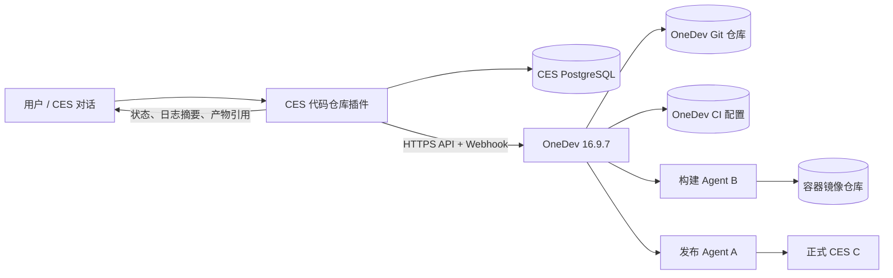
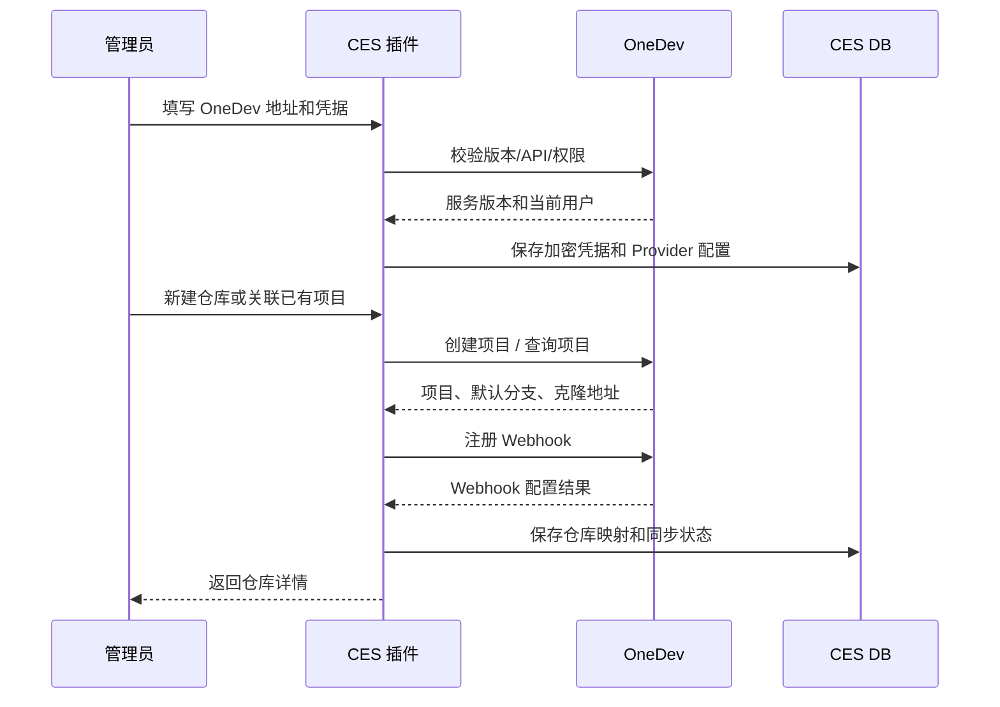

# CES 代码仓库管理插件设计

- 状态：P1 代码仓库接入已实现；项目镜像仓库、部署流水线未实现
- 日期：2026-11-04
- 分支：`feat/code-repository`
- 目标：在 CES 中管理平台相关代码仓库、代码提交和流水线，形成“开发 → 构建 → 候选验证 → 验收 → 发布”的闭环
- 关联方案：[CES 自演进服务器与基础设施](../ces-self-evolution-infrastructure/README.md)、[OneDev 初始化与 Agent 自动接入验证](../ces-self-evolution-infrastructure/ONEDEV_BOOTSTRAP_VERIFICATION.md)

## 0. 结论摘要

## 0.1 当前实现记录

- OneDev 16.9.7 已部署在 `49.233.139.12`，内网地址 `10.2.8.9`，HTTP 端口 80。
- CES 通过内网 `http://10.2.8.9` 访问 OneDev；OneDev 使用 PostgreSQL 持久化。
- 已创建测试项目 `ces-platform`，用于验证项目列表 API。
- CES 插件 `@smp/console-project-repositories` 已实现：
  - 平台设置 / 项目管理：OneDev 地址、用户名、密码配置与连接测试。
  - 侧边栏 / 项目仓库管理 / 项目代码仓库：通过 OneDev REST API 搜索和打开项目。
  - 项目镜像仓库、部署流水线：占位页面，等待后续设计。
- OneDev 密码使用 CES `secrets` 服务加密保存，不回到浏览器。
- 构建和部署流水线尚未实现，本文后续章节仍是目标设计，不代表已经具备这些能力。


1. **OneDev 作为代码仓库和流水线执行引擎，CES 插件作为控制面。**
2. CES 不内置 Git 仓库、不内置构建调度器，也不直接在 CES 进程里执行 Shell、Docker 或部署命令。
3. 第一版接入 OneDev 16.9.7；后续通过 Provider 适配层扩展 GitHub、GitLab 等外部仓库。
4. 流水线定义以仓库内的构建规范为唯一事实来源；CES 负责触发、展示、记录和审批，不复制一份可漂移的流水线脚本。
5. 构建、测试、候选部署和生产部署分开执行；生产部署必须绑定镜像摘要和用户验收，不允许验收后重新构建。
6. CES 数据库保存仓库索引、流水线运行摘要、审计和关联关系，不保存代码内容、不保存明文凭据。

## 1. 背景与边界

CES 已经支持服务器管理、COS、域名、Dashboard、Harness 等能力。当前代码开发与发布仍主要依赖人工操作：

- 代码托管、分支、提交没有统一的 CES 入口。
- 构建、测试、候选部署和生产发布之间的状态没有形成可追踪记录。
- 流水线日志、镜像摘要、验收结果和部署结果分散在不同工具中。
- CES 的正式运行环境与开发环境需要保持隔离，不能由 CES 直接执行任意构建命令。

本方案新增一个“代码仓库管理”插件，但不重新实现 Git 托管或 CI 引擎。

### 1.1 目标

- 统一管理 CES 相关代码仓库的接入、状态、分支和提交。
- 在 CES 中查看流水线运行、日志、报告和产物。
- 从 CES 手动触发构建或候选部署。
- 接收仓库 Push / Tag / Pull Request 事件，自动触发流水线。
- 将候选镜像、验收结果和生产部署记录在 CES 中。
- 支持把代码仓库和流水线能力扩展为其他 CES 插件项目的通用能力。
- 保持单用户 CES 的操作模型，不引入复杂的多租户 RBAC。

### 1.2 非目标

- 不实现 Git 协议、对象存储、代码编辑器或 Pull Request 代码评审系统。
- 不在 CES 容器内执行用户提交的任意命令。
- 不实现通用 CI Runner；构建与部署由 OneDev Agent 执行。
- 不实现多租户、组织级权限、跨团队审批。
- 不做代码全文搜索、IDE 和在线调试。
- 不自动把生产环境回滚到任意历史镜像；发布恢复仍遵循既有发布方案。
- 第一版不承诺 GitHub / GitLab 的双向同步或自动镜像。

## 2. 总体架构



职责划分：

| 组件 | 职责 |
| --- | --- |
| CES 代码仓库插件 | 仓库索引、连接配置、触发流水线、查询状态、保存运行摘要、展示页面、审计 |
| OneDev | Git 托管、构建规范、Webhook、任务调度、Agent 管理、构建日志、镜像和构建产物 |
| OneDev 构建 Agent | 在 B 上执行干净的安装、测试、镜像构建和候选部署 |
| OneDev 发布 Agent | 在 A 上执行经过验收的指定镜像发布、健康检查和恢复 |
| CES PostgreSQL | 保存仓库映射、运行摘要、验收和发布关联，不承担代码存储 |
| OneDev PostgreSQL | 保存 OneDev 自身项目、构建、用户和审计数据 |

第一版使用已有的 OneDev 基础设施方案。若某个部署没有 OneDev，则代码仓库插件不能启用流水线能力，只能显示“基础设施未配置”。

## 3. 代码仓库怎么接入

### 3.1 接入模式

接入层定义统一的 `CodeRepositoryProvider` 概念，第一版只实现 OneDev，后续增加其他 Provider。

| 模式 | 适用场景 | 第一版 | 说明 |
| --- | --- | --- | --- |
| OneDev 托管 | CES 相关仓库、需要 OneDev 流水线 | 是 | CES 调用 OneDev API 创建或关联项目 |
| 外部 Git 只读接入 | GitHub、GitLab 等已有仓库 | 否，P2 | CES 读取仓库、分支、提交和外部流水线状态 |
| 外部 Git 镜像到 OneDev | 外部仓库但必须使用 OneDev 构建 | 否，需验证 | 需要明确同步方向、冲突处理和镜像延迟 |
| 本地裸仓库 | 完全离线、极简部署 | 否 | 需要自行实现 Git 协议、鉴权和 Webhook，不推荐 |

第一版建议只支持 **OneDev 托管仓库**，避免同时解决 Git 托管、外部认证、外部 CI 和镜像同步四类问题。

### 3.2 管理端配置

在“平台设置 / 代码仓库”增加管理配置，至少包括：

- Provider 类型：OneDev
- OneDev Base URL，例如内网 `https://dev.ces.example.com` 或受控内网地址
- API 访问方式：Service Account Token 或 Basic Auth
- Webhook Secret
- 默认构建执行器：`ces-build-test`
- 默认发布执行器：`ces-production-deploy`
- 默认镜像仓库和项目路径
- 是否允许从 CES 创建新仓库
- 连接测试和最近一次同步时间

配置值保存到 CES 数据库；Token、密码和 Webhook Secret 使用现有 Fernet 密钥加密，接口只返回“已配置 / 未配置”，不回传明文。

### 3.3 接入流程



接入分为四个阶段：

1. **基础设施校验**
   - OneDev 可达，版本符合约束。
   - API 路径使用 `/~api`，不是 `/api`。
   - 服务账号具备项目读取、构建读取、构建触发和 Webhook 管理权限。
   - Agent 在线，构建执行器和发布执行器可匹配。

2. **仓库建立**
   - 新建：CES 调 OneDev API 创建项目、初始化默认分支、设置项目可见性。
   - 关联：选择已有 OneDev 项目，不复制代码，只保存映射。
   - 导入：P2 才考虑从外部 Git 导入；第一版不做自动镜像。

3. **Webhook 注册**
   - OneDev 项目 Webhook 指向 CES 的公开回调地址。
   - 使用独立 Secret 和签名校验。
   - 订阅 Push、Tag、Pull Request、Build 状态等事件。
   - 注册失败时仓库仍可手动触发，但标记“自动触发未就绪”。

4. **首次同步**
   - 拉取默认分支、最近提交、当前构建规范摘要。
   - 写入仓库索引和最近同步时间。
   - 失败不阻塞仓库创建，但页面显示明确错误和重试入口。

### 3.4 仓库标识和映射

CES 仓库记录必须同时保存：

- CES 内部仓库 ID
- Provider 类型
- Provider 外部项目 ID
- Provider 外部项目路径
- 默认分支
- Web 地址
- Clone 地址
- 最近一次同步的提交 SHA
- 凭据引用和 Webhook Secret 引用
- 启用状态和自动触发状态

唯一约束：

```text
(provider, provider_project_id)
```

不能只用仓库名作为唯一键，因为同一 OneDev 实例可能存在同名项目，或者未来接入多个 Provider。

### 3.5 代码流向

CES 不在数据库里保存代码，也不代替 Git 客户端。

推荐流向：

```text
C 的开发工作区 / 本地仓库
  → git push
  → OneDev 仓库
  → OneDev 构建 Agent 拉取准确 SHA
  → 候选镜像
  → 验收
  → 发布
```

代码提交由用户或 CES 对话中的编码代理完成，插件只负责：

- 展示仓库和提交；
- 触发针对某个 commit SHA 的流水线；
- 记录该 SHA 对应的运行和产物；
- 链接 OneDev 页面和日志。

### 3.6 仓库页面形态

代码仓库是 `console.page` 页面，建议放在“平台设置 / 代码仓库”或独立侧边栏分组。页面结构：

```text
代码仓库
├─ 仓库列表
│  ├─ 名称 / Provider / 默认分支
│  ├─ 最近提交 / 最近流水线状态
│  ├─ 自动触发状态
│  └─ 操作：打开、同步、新建、停用、删除映射
└─ 仓库详情
   ├─ 概览
   ├─ 分支
   ├─ 提交
   ├─ 流水线运行
   ├─ 构建规范
   └─ 设置
```

仓库列表复用现有插件列表和表格交互，不新增一套列表组件。

仓库详情建议用右侧抽屉或独立详情页；第一版用独立页面，便于承载流水线运行和日志。

### 3.7 删除和停用语义

- **停用仓库**：CES 停止自动触发和 Webhook 处理；不删除 OneDev 项目。
- **移除映射**：删除 CES 本地仓库记录，不删除 OneDev 仓库；必须二次确认。
- **删除仓库**：第一版不提供从 CES 删除 OneDev 项目；避免误删代码。
- **外部 Provider 只读模式**：停用只影响 CES 自动触发，不影响外部仓库。

## 4. 流水线怎么处理

### 4.1 执行模型

不建议在 CES 里实现自己的 CI 调度器。流水线使用 OneDev 的原生 CI：

- 流水线定义放在仓库内，随代码版本控制。
- OneDev 负责调度、并发控制、Agent 选择、日志和构建状态。
- CES 通过 OneDev API 触发和读取流水线。
- 构建和部署使用不同 Agent，不能让普通构建任务落到生产发布 Agent。
- CES 不直接执行构建命令，不挂载 Docker Socket，不持有构建机 SSH 密钥。

### 4.2 构建规范

建议每个 CES 相关仓库包含 `.onedev-buildspec.yml`，作为唯一流水线事实来源。CES 可以：

- 在仓库初始化时生成一份推荐模板；
- 在 UI 中展示规范摘要和版本；
- 在运行时读取参数、阶段和产物；
- 但不把 UI 中编辑的脚本直接覆盖仓库文件。

第一版不建议在 CES 里做任意 YAML 在线编辑器。需要修改流水线时，修改仓库文件并走同一套提交流程，保证可追溯。

### 4.3 推荐的 CES 流水线阶段

```text
1. checkout
2. prepare
3. verify
4. test
5. build-image
6. scan/check
7. push-image
8. candidate-deploy
9. candidate-smoke / e2e
10. archive-report
11. manual acceptance
12. promote-image
13. production-deploy
14. production-health-check
15. release-record
```

分阶段职责：

| 阶段 | 执行位置 | 内容 | 失败处理 |
| --- | --- | --- | --- |
| checkout | B Agent | 按准确 SHA 干净检出 | 失败即终止 |
| prepare | B Agent | 安装锁定依赖、恢复缓存 | 终止，不自动忽略 |
| verify | B Agent | 类型检查、Lint、插件契约检查 | 终止 |
| test | B Agent | 单元测试、集成测试、必要的 Playwright | 终止，报告归档 |
| build-image | B Agent | 构建候选镜像，固定版本标签 | 终止 |
| scan/check | B Agent | 依赖/镜像基础检查，按需启用 | 终止或警告，规则决定 |
| push-image | B Agent | 推送到 OneDev 内置 Registry | 终止 |
| candidate-deploy | B Agent | 部署候选 CES，使用独立数据和端口 | 终止，保留诊断 |
| candidate-smoke | B Agent | 登录、核心页面、插件健康检查 | 终止，候选不可验收 |
| archive-report | B Agent | JUnit、日志、截图、镜像摘要归档 | 不阻塞验收但必须记录 |
| manual acceptance | CES | 用户确认候选版本 | 未通过则回到开发 |
| promote-image | A | 只提升摘要，不重新构建 | 终止 |
| production-deploy | A 发布 Agent | 串行替换正式容器 | 失败进入恢复 |
| health-check | A | 登录、数据库、插件、核心工具 | 失败恢复或维护 |
| release-record | A / CES | 保存版本、摘要、报告和恢复点 | 记录失败也要标记 |

### 4.4 触发方式

| 触发 | 场景 | 行为 |
| --- | --- | --- |
| 手动 | 用户在 CES 选择分支和 commit | 立即请求 OneDev 构建 |
| Push | 默认分支或指定分支推送 | Webhook 校验后触发 |
| Tag | 发布标签 | 触发构建/候选，不自动生产发布 |
| Pull Request | P2 | 只做验证，不部署 |
| 重试 | 上次失败且代码未变 | 复用同一 SHA，创建新运行 |
| 定时 | 可选 P3 | 依赖更新、定期验证 |

触发参数必须包含：

- 仓库 ID
- 准确 commit SHA
- 分支或 tag
- 流水线 profile
- 触发来源和请求人
- 幂等键

### 4.5 运行状态机

```text
queued
  → running
  → succeeded
  → failed
  → canceled

succeeded（候选）
  → awaiting_acceptance
  → accepted
  → promoting
  → promoted
  → deploying
  → deployed
  → deploy_failed
```

原则：

- 状态只能向前推进，不能从已成功回退到运行中。
- 重试创建新的运行记录，不覆盖旧记录。
- 一个运行对应一个 commit SHA 和一个镜像摘要。
- 验收绑定具体运行和镜像摘要，不能只绑定分支。
- 生产部署只接受 `accepted` 的候选摘要。
- 同一仓库同一时间默认只允许一个构建运行；生产部署全局串行。

### 4.6 构建、候选和发布分离

第一版采用三段式：

1. **构建**：B 上生成候选镜像并推送 Registry，记录完整摘要。
2. **候选验证**：B 上部署候选 CES，用户访问测试地址验收。
3. **生产发布**：A 的发布 Agent 只按摘要部署到 C，不重新构建。

这样可以保证：

- 验收的镜像和正式运行的镜像一致；
- 候选验证失败不会影响正式环境；
- 构建失败不占用生产发布队列；
- 发布失败可以回到上一版本或进入维护状态。

### 4.7 并发、超时和取消

- 每仓库构建并发：1（第一版）。
- 生产部署并发：1，且使用全局锁。
- 触发时若已有同 SHA 的运行：
  - 已成功：直接返回已有运行；
  - 正在运行：返回现有运行，不重复创建；
  - 已失败：允许显式重试。
- 每个运行设置最大时长；超时后由 OneDev 终止，CES 记录 `failed` 并保留日志链接。
- 用户取消只取消 OneDev 运行；已经推送的镜像保留但不可发布。
- Webhook 重复投递通过事件 ID 和幂等键去重。

### 4.8 日志、报告和产物

CES 记录摘要，OneDev 保留完整执行记录：

- OneDev 构建 ID 和运行 URL
- 触发事件和请求人
- commit SHA、分支/tag
- 开始/结束时间
- 阶段状态和失败阶段
- 镜像仓库、镜像摘要、平台
- 测试报告和评估结果引用
- 候选环境地址和验收状态
- 发布记录和恢复版本

不在 CES 数据库中保存完整构建日志，避免日志膨胀和重复存储。页面通过链接跳转 OneDev，或通过服务端代理按需读取。

### 4.9 凭据和权限

- OneDev API Token 只保存在 CES 加密配置中。
- Git 克隆凭据和构建密钥由 OneDev Agent/任务环境持有，不进入 CES 前端。
- 镜像仓库凭据存入 OneDev 项目 Secret，不进入仓库文件。
- 生产 SSH 凭据只属于发布 Agent，普通构建 Agent 不可访问。
- Webhook Secret 独立于 API Token。
- 所有触发、验收、发布和配置修改写审计记录。

### 4.10 失败处理

| 场景 | 处理 |
| --- | --- |
| Webhook 丢失 | 定时对账最近运行和提交，手动同步兜底 |
| OneDev 不可达 | 页面显示不可用；不产生虚假成功状态 |
| Agent 离线 | OneDev 任务保持排队或失败；CES 显示执行器状态 |
| 构建失败 | 运行标记 failed，允许新提交或显式重试 |
| 候选健康检查失败 | 候选标记不可验收，不进入生产 |
| 发布中断 | 发布 Agent 核对容器、摘要和健康状态，不重复并发替换 |
| 验收后代码变化 | 旧验收失效，必须重新构建和验收 |
| CES 重启 | 以 OneDev 和发布记录为事实来源，恢复展示，不重放已成功发布 |

## 5. 数据模型

第一版建议增加以下表。表名以现有 database 插件的命名和迁移规范为准。

### 5.1 `code_repository`

- `id`
- `name`
- `slug`
- `provider`（`onedev`，未来扩展 `github`、`gitlab`）
- `provider_project_id`
- `provider_project_path`
- `web_url`
- `clone_url`
- `default_branch`
- `credential_ref`
- `webhook_secret_ref`
- `auto_trigger`
- `status`（`active`、`disabled`、`error`）
- `last_synced_commit`
- `last_synced_at`
- `last_error`
- `created_at` / `updated_at`

唯一约束：`(provider, provider_project_id)`。

### 5.2 `pipeline_run`

- `id`
- `repository_id`
- `provider_run_id`
- `provider_build_url`
- `commit_sha`
- `ref`
- `trigger`（`manual`、`push`、`tag`、`webhook`、`retry`）
- `requested_by`
- `profile`
- `status`
- `stage`
- `image_repository`
- `image_digest`
- `image_platform`
- `started_at` / `finished_at`
- `acceptance_status`
- `accepted_at`
- `release_id`
- `error_summary`
- `created_at` / `updated_at`

索引：`repository_id + commit_sha`、`status`、`provider_run_id`。

### 5.3 `pipeline_stage`

- `id`
- `run_id`
- `name`
- `status`
- `started_at` / `finished_at`
- `log_url`
- `summary`
- `error`

### 5.4 `pipeline_artifact`

- `id`
- `run_id`
- `kind`（`image`、`junit`、`screenshot`、`report`、`sbom`）
- `name`
- `uri`
- `digest`
- `size`
- `expires_at`

### 5.5 保留策略

- 运行摘要和发布记录长期保留。
- 构建日志和大型产物由 OneDev 保留策略管理，CES 只保留引用。
- 过期产物链接明确标记，不伪造可用状态。
- 删除仓库映射不删除 OneDev 构建和代码；历史运行保留或按策略归档。

## 6. API 和页面接口

### 6.1 管理接口

建议的 CES 内部接口：

```text
GET    /console-api/code-repositories
POST   /console-api/code-repositories
GET    /console-api/code-repositories/:id
PATCH  /console-api/code-repositories/:id
DELETE /console-api/code-repositories/:id          # 只删除 CES 映射
POST   /console-api/code-repositories/:id/sync
POST   /console-api/code-repositories/:id/test
GET    /console-api/code-repositories/:id/branches
GET    /console-api/code-repositories/:id/commits
POST   /console-api/code-repositories/:id/runs
GET    /console-api/pipeline-runs/:id
POST   /console-api/pipeline-runs/:id/cancel
POST   /console-api/pipeline-runs/:id/retry
POST   /console-api/pipeline-runs/:id/accept
POST   /console-api/pipeline-runs/:id/promote
```

### 6.2 Webhook 接口

```text
POST /console-api/code-repositories/webhooks/:provider/:repositoryId
```

要求：

- 不依赖登录 Cookie。
- 校验签名、时间戳和事件 ID。
- 只接受已配置仓库的事件。
- 事件处理幂等。
- 不把原始 payload 无限制写入数据库；只保存必要摘要和投递结果。
- 失败返回可重试状态码，并在 CES 记录投递结果。

### 6.3 页面权限

CES 仍是单用户系统，第一版只区分：

- 已登录用户可以查看仓库、运行和日志链接。
- 只有管理员配置可以修改 Provider、凭据、自动触发和发布设置。
- 后续如需多用户，再引入项目级权限；第一版不预埋复杂 RBAC。

## 7. 实施阶段

### P0：接入验证

- 确认 OneDev 16.9.7 已部署并可从 CES 访问。
- 验证 API、Basic/Token 认证、项目查询、构建触发、构建状态和日志读取。
- 验证 Webhook 注册和签名。
- 验证构建 Agent 和发布 Agent 的执行器匹配。
- 明确 OneDev 内置 Registry 的地址和凭据注入方式。

### P1：仓库与手动流水线

- 平台设置中的代码仓库 Provider 配置。
- OneDev 仓库关联和新建。
- 仓库列表、详情、分支、提交、最近运行。
- 手动触发构建。
- 运行列表和状态轮询。
- CES 数据库迁移和审计记录。

### P2：自动触发与候选验证

- Webhook 接入和幂等处理。
- Push / Tag 自动触发。
- 构建日志链接、报告和镜像摘要归档。
- 候选环境部署和候选 URL 展示。
- 验收状态和候选版本绑定。
- 失败重试、取消、定时对账。

### P3：外部仓库和发布闭环

- GitHub / GitLab 只读 Provider。
- 外部流水线状态读取。
- 流水线模板管理。
- 生产发布、健康检查和恢复记录。
- 如果确实需要外部仓库使用 OneDev 构建，再单独验证镜像/同步方案。

## 8. 验收标准

1. 在 CES 中能配置 OneDev 并完成连接测试，错误配置不会显示为成功。
2. 能关联一个已有 OneDev 仓库，并展示默认分支、最近提交和 Webhook 状态。
3. 能手动触发指定 commit 的流水线，并看到 queued/running/succeeded/failed 状态。
4. Webhook 重复投递不会创建重复运行；丢失事件可通过同步补偿。
5. 运行详情能看到阶段、日志链接、commit SHA 和镜像摘要。
6. 候选验收绑定具体镜像摘要；代码变化后旧验收不能用于新构建。
7. 生产发布只接受已验收摘要，且不会重新构建。
8. OneDev 不可达、Agent 离线、Webhook 失败和取消操作都有明确状态，不产生虚假成功。
9. 明文 Token、SSH Key、Registry 密码不出现在页面、日志或数据库中。
10. 仓库停用后不再自动触发，OneDev 项目和数据仍存在。

## 9. 待确认问题

1. 第一版是否只支持关联已有 OneDev 项目，还是同时允许 CES 创建项目？
2. OneDev 是否已经按自演进方案部署；如果没有，代码仓库插件是否只做只读展示？
3. GitHub / GitLab 是否必须进入第一版，还是明确放到 P3？
4. 生产发布是否复用现有发布 Agent，还是由代码仓库插件单独触发部署服务？
5. 流水线规范模板由 CES 生成后提交到仓库，还是完全由仓库自行维护？
6. 候选验收记录是否必须与用户对话绑定，还是允许在代码仓库页面独立验收？
7. 是否需要保存构建日志副本以支持 OneDev 数据损坏后的审计；如果需要，应单独设计归档和保留策略。

## 10. 建议的第一版取舍

建议第一版只做：

```text
OneDev 单 Provider
+ 关联已有仓库
+ 手动触发构建
+ 运行状态和日志链接
+ 镜像摘要和候选记录
+ 基础审计
```

暂不做：

```text
GitHub / GitLab
外部仓库自动镜像
CES 内在线编辑流水线
从 CES 删除 OneDev 项目
多用户权限
自动生产部署
```

这样可以在不重新实现 Git 和 CI 的前提下，先把“代码仓库可见、流水线可触发、结果可追踪”这个最小闭环落地。
