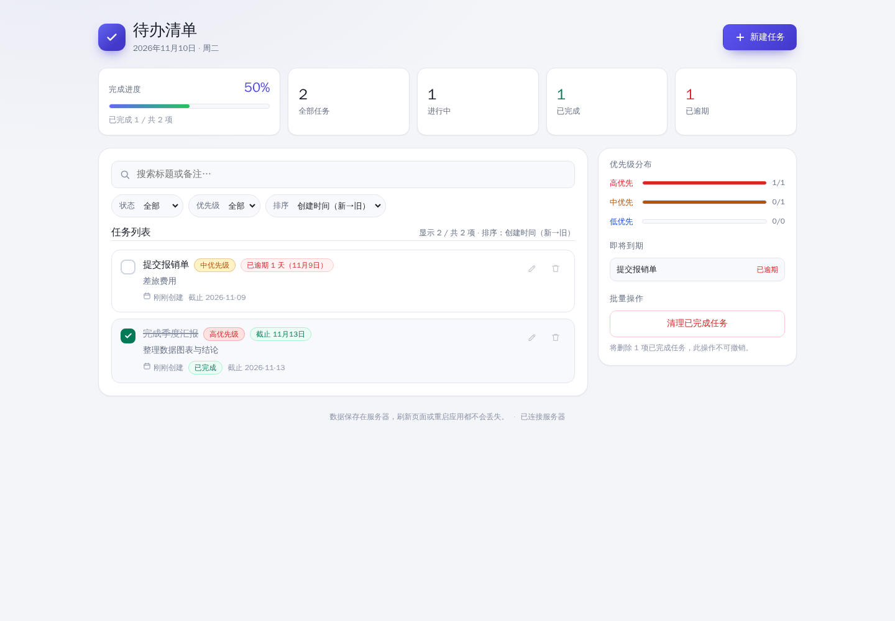

# 新项目自主交付实施与验收

- 日期：2026-11-10，Asia/Shanghai。
- 状态：平台修正已上线，实际 AI 完整交付与独立验收完成；公网访问限制见第 5 节。
- 分支：`codex/harness-project-delivery`。
- 平台运行提交：`6142efa96f64a1a5a753e5b937880a19416e8485`。

## 1. 平台变更

统一 Git 地址、身份与连接参数的工具返回；移除系统提示中的固定 IP。项目设置保存 SSH 根地址、托管空间、执行器和 Node 基础镜像，旧设置保存操作不会丢失这些字段。

`create_project` 创建托管空间内的项目，返回仓库与授权就绪状态；同一项目重试可补齐失败的授权。既有非托管项目不改变授权。工具支持完整 OneDev 项目路径；`prepare_delivery` 检查执行器和在线 Agent，创建或复用该项目的私有镜像仓库。工具不会把仓库存在当成推送成功，实际构建负责验证。

线上建立了 `apps` 父项目（ID 5，不启用代码仓库），`ces-build-test` 的 Job 匹配加入 `apps/**` 下的 `build`，保留 `ces-platform` 与 `harness-delivery-test`；仍使用现有 OneDev 主机上的 Agent，并发 1。

CES 构建 ID **8**、项目内编号 **5** 成功，部署镜像为：

```text
ccr.ccs.tencentyun.com/zstao/ces-integration@sha256:d3ad175a13b58231d720bdec486643db662df22ee6b1c7c2967175b8b9997408
```

只更新 CES Compose 的镜像并重建该服务；原 Compose、设置与回执位于 CES 主机 `/opt/ces/backups/harness-bootstrap-20261110/`。原镜像保留为 `ces:pre-bootstrap-20261110`。容器恢复 healthy，更新后的 Skill 已安装。没有新增平台数据库表或迁移。

本地 32 项插件测试、类型检查、全工作区构建与差异检查通过。新增测试覆盖 SSH 地址一致性、创建授权失败后的恢复、托管范围边界、拒绝授权不写入、TCR 创建响应丢失后的核对、公开仓库冲突、在线 Agent 分页以及设置兼容。

## 2. 无技术提示的实际会话

全新标准 Harness 会话：`session-1b0b9ad0-373c-43d1-8246-8e7a91cb0de1`，标题“新项目自主交付验收”。会话使用空工作区 `/srv/workspaces/harness-bootstrap-verification`。仅该验收会话使用完全访问权限，验收后恢复为 `workspace-write`。

原始提示全文：

> 请创建一个完整的中文待办应用，部署到 B-163-98。
>
> 需要可用的浏览器界面和后端，支持任务新增、编辑、删除、完成状态、优先级、截止日期、搜索筛选和统计。界面适配电脑和手机，操作有清晰反馈；刷新页面和重启应用后数据仍然保留。
>
> 请自主完成开发、测试和部署。使用独立应用和空闲端口，保持服务器上已有服务运行。最后给出项目仓库入口、构建与发布结果、测试结果和实际访问方式。

提示没有提供仓库地址、工具名称、执行器、基础镜像、镜像仓库、目录或命令。

已观察到 AI 自行加载 `project-delivery`、查询服务器，调用 `create_project` 创建 **`apps/zh-todo`（ID 6）**，仓库与 AI 写入权限一次准备成功。Git 地址来自工具返回的内网 SSH 配置。随后自行调用 `prepare_delivery`，创建专属私有镜像仓库 **`zstao/ces-project-6`**，并发现可用构建 Agent。

### 自主开发过程

AI 在空仓库中创建 Node.js 后端、原生浏览器前端、持久化存储、18 项集成测试、Dockerfile、Compose、OneDev 构建配置、发布配置与 README。业务代码由该 Harness 会话编写，平台实施人员没有代写应用或提供仓库地址。

过程中发生的错误由 AI 自行修复：首次克隆未携带工具返回的 SSH 参数；Node 测试入口使用了目录；部分字段更新的校验错误导致完成状态、统计与持久化断言失败。AI 定位并修正了业务校验，关闭测试连接并终止旧测试进程，随后 18 项测试通过。一次尝试使用未安装的 Python，也自行改用现有 Node 完成操作。以上没有补充人工技术提示。

AI 首次提交 `b560bac8f489a0e5f10c535dd850fa003cbe20bb`，通过工具发现并触发 `build`，构建 ID 9 成功。随后自行检查构建日志，发现 Dockerfile 运行阶段未依赖测试阶段，于是提交 `c550df276900696444372ddd25b2209dcacb22ae`，用 `COPY --from=test` 建立依赖，再触发构建 ID **10**（项目内编号 **2**）。独立读取该次 OneDev 日志，确认实际执行了 18 项测试，全部通过，并成功推送镜像和发布 `image.json`。

AI 自行准备环境文件，通过 `platform_server_rsync` 传输固定提交快照与发布请求，调用现有后台发布运行时。发布 `rel-20261110-1` 使用构建 10 的 digest，目标容器 `ces-project-6-web-1` healthy，端口 `18100`，数据卷 `ces-project-6_todo-data`，进程用户为非 root 的 `node`。独立 Docker inspect 核对运行镜像与产物一致。

AI 通过服务器工具验证了实际 API，并重启新容器确认 3 项验收数据保留。公网 `18100` 连接失败，未修改网络策略；独立验收通过 SSH 转发访问实际部署服务。

### 浏览器验收反馈

首版已经自主走通创建仓库、开发、测试、构建推送和部署，但**首版界面验收未通过**：独立浏览器看到 3 项任务时，列表下方仍显示“还没有任务”的空状态。这不是平台接入缺口，需由应用 AI 继续修复。发送的业务验收反馈全文如下，没有给出代码修法、仓库地址或工具参数：

> 独立浏览器验收发现：列表已有 3 项任务时，下方仍显示“还没有任务”和“新建任务”空状态。请修正这个界面问题，并确认搜索无结果与正常列表的空状态切换正确；继续完成验证、构建和部署。保持已有数据和其他服务。

AI 自行定位到组件的 `display: flex` 覆盖浏览器默认 `[hidden]` 样式，增加全局隐藏规则，并将 17 项真实浏览器回归检查写入项目。修复还恢复了新建表单中完成状态开关的正确隐藏。原有 46 项 Chromium 检查再次通过，18 项 API 测试再次通过；平台实施人员没有编辑应用代码。

## 3. 最终交付与独立验证

| 项目 | 实际结果 |
| --- | --- |
| 代码仓库 | [apps/zh-todo](http://49.233.139.12/apps/zh-todo)，OneDev ID 6，`main` |
| 应用提交 | `20232ac87172acb4e0598c3cfaeb6fd10243bab1` |
| 最终构建 | ID **11**，项目内编号 **3**，`SUCCESSFUL` |
| 最终发布 | `rel-20261110-2`，`succeeded / complete` |
| 服务器与目录 | B-163-98，`/srv/apps/project-6` |
| 服务与数据 | `ces-project-6-web-1`，端口 `18100`，卷 `ces-project-6_todo-data` |

最终镜像：

```text
ccr.ccs.tencentyun.com/zstao/ces-project-6@sha256:1513e99fd2cae991e1f65914e771d52fbbddfdb7135485102f533d61a7e63139
```

独立读取 OneDev 构建 11 状态、日志及 `image.json`，核对提交、18 项测试实际执行且零失败、推送成功与 digest；通过服务器 Docker inspect 核对运行镜像一致且 healthy。

独立 API 验收共 **15 项检查通过**：健康、新增字段、单条读取、局部编辑保留其他字段、关键字搜索、优先级筛选、逾期筛选、完成状态、已完成与进行中筛选、统计、非法输入、删除、重启持久化及测试数据清理。唯一测试任务先在首版创建，修复版发布后仍完整保留，再实际重启新容器，核对其 ID、标题、备注、优先级、截止日期、完成状态和完成时间均未变化；最后只删除该测试任务。

独立浏览器通过 SSH 转发访问**服务器实际部署的服务**，验证：

- 新增、编辑、优先级与截止日期保存；完成状态和统计联动；刷新后仍保留。
- 删除确认与删除后的空状态；新建表单必填校验。
- 列表有数据时空状态实际不可见；搜索无结果显示“没有匹配的任务”；清除筛选恢复列表。
- 1280px 桌面布局、390px 手机布局均无横向溢出；手机表单可用；浏览器无 error/warn 日志。

浏览器专用测试任务也已删除，最终应用任务数为 0。B 上已有 `plan-a-ces`、`plan-a-pg`、`tcr-deploy-test`、`tcr-ai-test`、`ces-harness-delivery-test-web-1` 保持运行，端口和服务未调整。验收会话权限已恢复为 `workspace-write`。

下图是 Harness AI 在临时测试实例运行 Chromium 生成的修复版截图；其前后端资源哈希已与部署容器核对一致。实际部署页面另外完成了上述独立浏览器验收。



[手机浏览器验收截图](./images/mobile.png)

## 4. 幂等性、续接与实际工具调用

应用交付和修复完成后，专门追加第三回合，明确要求重复调用 `create_project`、`prepare_delivery` 并查询已有发布。这是有工具名称提示的专项接口验收，**不计入首回合“只有自然需求”的入口验证**。

结果：

- `create_project` 返回 `created:false`，项目 ID 仍为 6，路径仍为 `apps/zh-todo`，`access.ready:true / changed:false`；Git SSH 地址不变。
- `prepare_delivery` 返回 `prepared:true`，`image.created:false / private:true`，仓库仍为 `zstao/ces-project-6`。它仍保留 `pushVerified:false` 的语义，推送成功证据来自真实构建，而非这次预检。
- 查询得到构建仍只有 ID 9、10、11；发布目录仍只有两次既有发布。`current.json` 指向构建 11、修复提交和最终 digest；发布锁空闲。没有额外触发构建或发布。

从会话事件读取到的实际工具调用如下，包含开发中的失败与自主重试，以及后两回合验收；不是根据 AI 的最终文字推测：

| 工具 | 次数 | 用途 |
| --- | ---: | --- |
| `skill` | 1 | 自行加载 `project-delivery` |
| `platform_server_list` | 1 | 按用户给出的名称发现目标服务器 |
| `platform_onedev` | 21 | 创建/复用、交付准备、任务发现、构建触发、状态/日志/产物查询 |
| `platform_server_exec` | 22 | 环境探测、后台发布、健康与业务测试、重启及状态续接 |
| `platform_server_rsync` | 4 | 两次发布的固定提交快照与请求传输 |
| `bash` / `write` / `edit` | 55 / 17 / 7 | 应用开发、Git 提交推送、本地测试与浏览器测试 |
| `job_output` / `job_kill` / `job_list` | 11 / 4 / 1 | 后台任务观察与本次临时任务收尾 |
| `todo_write` / `present` / `read_image` | 2 / 2 / 1 | 任务跟踪、截图交付与读图尝试 |

`platform_onedev` 的 21 次细分为：`create_project` 2、`prepare_delivery` 2、`list_jobs` 2、`run_job` 3、`get_build` 5、`get_build_logs` 3、`get_build_artifact` 3、`list_builds` 1。

本次没有向首回合提供仓库地址或构建参数。只有一次业务界面缺陷反馈，以及一次明确的幂等性/续接专项指令。首版界面问题不被隐去，也不将首版自动化检查通过等同于最终界面验收通过。

## 5. 访问方式与验证边界

服务器内部地址为 `http://127.0.0.1:18100/`。本次从 CES、另一台测试服务器及工作机检查公网 `43.163.113.98:18100`，均未获得成功响应；没有修改云网络策略或原有 80 端口服务，也没有把内部健康检查当成公网可用。具体网络拦截位置尚未通过云端配置核实。

具有该服务器 SSH 权限时，可用现有授权私钥转发后访问：

```sh
ssh -i /path/to/authorized-key -N \
  -L 127.0.0.1:18160:127.0.0.1:18100 ubuntu@43.163.113.98
```

然后打开 `http://127.0.0.1:18160/`。验收期间曾发生本机临时 SSH 隧道断开；重连后核验服务器容器健康、数据完整，未将转发失败误记为应用故障。临时转发不代表公网端口已经开放。

AI 的 Chromium 自动化在 CES 的临时测试实例执行；其使用的模型不支持图像输入，`read_image` 尝试失败，因此视觉验收由独立浏览器补齐。18 项 API 测试属于镜像构建的必经阶段；46 项完整 UI 检查和新增 17 项回归检查在 Harness 开发环境运行，未宣称它们已加入 OneDev 镜像构建阶段。
