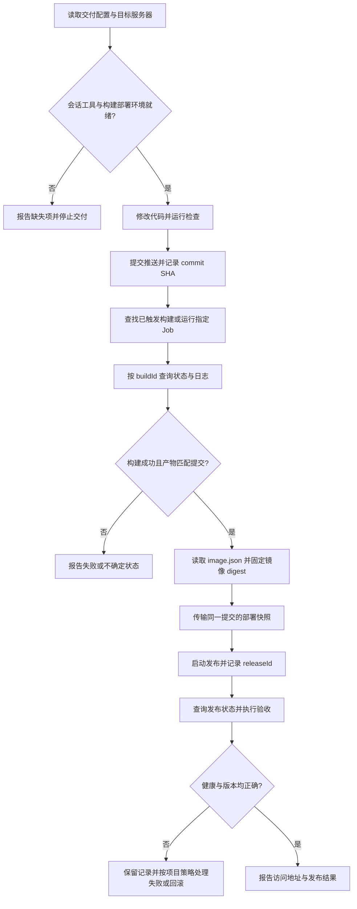

# Harness 项目构建与部署全流程方案

- 状态：P0–P3 已实现、上线并完成实际 Harness 会话交付、幂等与中断恢复验收；P4 保留为后续可选工作。
- 日期：2026-11-10。
- 范围：Harness 工具、OneDev 构建、TCR 镜像产物、应用服务器部署及交付 Skill。
- 当前基础：保留已发布的应用服务器 TCR 自动注入流程。已在现有主 OneDev 主机上线构建 Agent、配置执行器，并发布包含交付工具与 Git/SSH/rsync 的 CES 镜像。初始缺口见[只读核验快照](ONLINE_VERIFICATION.md)，实施变更与实际验收见[实施记录](IMPLEMENTATION.md)。

## 1. 目标与首版范围

用户在 Harness 会话中提出“修改项目并部署到指定应用服务器”后，Harness 能完成代码检查、提交、构建、获取镜像、部署、健康检查和结果反馈。会话中断后，可以通过构建 ID 和发布 ID 继续确认结果。

首版采用以下组合：

1. 补齐 CES 的 Git、OpenSSH 客户端和 rsync，并配置能够实际构建、推送镜像的 OneDev 执行器。
2. 扩展现有项目仓库插件中的 `platform_onedev`，补齐任务发现、触发、构建查询和产物读取。
3. 复用 `platform_image_registry`、服务器 SSH 执行、文件传输及现有权限机制。
4. 增加 `project-delivery` Skill，附带项目构建、Compose 和部署脚本模板。
5. 项目运行参数保存在仓库配置中，发布状态保存在应用服务器的应用目录中。

首版以单个项目、单个环境、单台应用服务器为交付单元，不新增独立部署插件、后台编排服务或数据库表。多应用统一管理页面、集中发布历史、集群调度、灰度与零停机发布留待后续需求明确后设计。

## 2. 职责与执行位置

| 参与方 | 职责 | 执行位置 |
| --- | --- | --- |
| Harness | 编辑代码、运行必要检查、提交推送、调用工具、跟踪结果、执行验收 | 当前会话工作区与 CES 工具宿主 |
| OneDev | 接收并调度构建任务，保存构建状态、日志和产物 | 已配置的 OneDev 服务 |
| OneDev 执行器 | 检出指定代码、测试、构建 Docker 镜像、推送 TCR、输出 `image.json` | P0 配置并验证的构建环境，优先使用现有主 OneDev 宿主机 |
| TCR | 保存镜像，提供 digest 对应的镜像读取 | 现有镜像仓库 |
| 应用服务器 | 拉取确定版本的镜像、运行 Compose、执行健康检查、保存发布结果 | 已登记且准备完成的应用服务器 |

构建由 OneDev 调度，具体构建命令由执行器运行。初始线上只有匹配 demo 的服务端 Shell 执行器。实施后，在现有主 OneDev 宿主机部署了 `ces-build-agent`，并配置 `ces-build-test` Remote Shell Executor，并发为 1，仅匹配 `ces-platform`、`harness-delivery-test` 的 `build` Job；已有 `ces-demo` 保留。没有新增服务器。新项目首次接入时需要扩展执行器的项目匹配范围。Agent 是执行构建的进程。

构建环境按 OneDev 16.9.7 实测配置。Agent 使用固定镜像 digest，通过宿主机 Docker socket 构建；真实 Job 已完成测试应用与 CES 镜像的构建、推送和 `image.json` 产物发布。可复用配置见 [Agent 部署说明](../../../deploy/onedev-build-agent/README.md)。

Agent 安装与执行器匹配参考 OneDev 官方的 [Agent 管理](https://docs.onedev.io/administration-guide/agent-management)和[构建 Agent 配置](https://docs.onedev.io/tutorials/cicd/agent-farm)。具体安装指令以线上实例生成的内容为准，不直接套用文档示例的构建规范版本。

应用服务器使用已有类型准备流程注入的拉取凭据。构建端使用执行环境中的推送凭据；凭据不放入项目仓库或构建产物。

## 3. 现有能力与缺口

### 3.1 实施前的线上核验结论

| 检查项 | 2026-11-10 实测结果 | 对方案的影响 |
| --- | --- | --- |
| CES 与应用服务器 | CES 健康；B-163-98、test-72-83 可连接且已安装 Docker/Compose；专用 TCR 配置文件存在；B 上已有测试应用返回 HTTP 200 | 保留现有服务器准备和凭据注入；仍需实际拉取与部署验收 |
| CES 命令依赖 | 容器内缺少 `git`、`ssh`、`rsync` | 在 CES 运行镜像中补齐，不能只注册工具就视为可用 |
| OneDev 执行器 | Agent 列表为空；唯一执行器 `ces-demo` 是 Server Shell Executor，仅匹配 demo | 缺少正式构建执行器；没有 Agent 不等于 OneDev 完全不能运行任务 |
| 真实构建环境 | OneDev 容器没有 Docker socket，也未配置 `DOCKER_HOST`；`docker info` 返回失败 | 必须补齐实际 Job 的 Docker 执行环境 |
| 仓库与构建记录 | 主分支已有 `build/candidate/release/rollback`；引用的 `ces-build-test`、`ces-production-deploy` 未配置；查询到的成功构建仅为历史 demo | 流水线文件存在和 demo 成功均不代表正式构建可用 |
| 镜像与工具 | TCR 仓库、标签和 digest 查询成功；线上 OneDev 工具缺少三个拟新增动作；技能目录只有演示 Skill | 保留查询能力，补齐工具和交付 Skill |

本表保留实施前的只读快照。实施后的构建、推送、拉取与部署结果单独记入[实施记录](IMPLEMENTATION.md)，避免将历史检查和本次发布混为一谈。

### 3.2 能力复用与改动

| 环节 | 已有能力 | 首版处理 |
| --- | --- | --- |
| 代码仓库 | `platform_onedev` 创建和查询项目，读取分支、提交和文件；现有系统提示约定 Git 身份与 SSH 推送方式 | 补齐 CES 的 Git/OpenSSH 依赖，验证实际会话编辑与推送，不另建 Git 插件 |
| 流水线监控 | `list_builds`、`get_build`、`get_build_logs` | 增加准确查询、任务发现、主动触发和产物读取 |
| 镜像查询 | `platform_image_registry` 的 `list_repositories`、`list_tags`、`get_tag` | 复用，修复标签查询范围限制 |
| 服务器发现 | `platform_server_list`、`platform_server_group_list`、`platform_server_get` | 通过返回的服务器 ID 选择部署目标 |
| 远端执行 | `platform_server_exec`，使用平台 SSH 凭据和已有审计 | 调用部署脚本、查询状态、执行验收 |
| 文件传输 | `platform_server_rsync` 已注册，但 CES 缺少所需命令 | 补齐本地 rsync、ssh、ssh-keyscan，验证传输后用于发布快照 |
| 服务器准备 | 应用服务器类型、Docker/Compose 软件准备、TCR 自动注入 | 复用；普通项目部署不重复注册或重装服务器 |
| 服务器管理 | `platform_server_admin`、`platform_server_group_admin`、`platform_server_upgrade_admin` 等 | 保持服务器运维会话的作用域，不将其全部开放给普通开发会话 |
| Skill 管理 | Harness 技能目录支持导入、启用和查看 Skill | 用于安装 `project-delivery` |
| 现有发布脚本 | CES 自身已有构建、发布、验证和回滚脚本 | 提取通用模板，解除固定目录、容器名称和健康地址的依赖 |

源码依据：

- [OneDev 与镜像工具](../../../plugins/project-repositories/src/index.ts)、[OneDev 客户端](../../../plugins/project-repositories/src/onedev.ts)。
- [服务器工具注册](../../../plugins/server-management/src/host/harness/tools.ts)、[服务器管理工具作用域](../../../plugins/server-management/src/host/admin/workspace-tools.ts)。
- [应用服务器类型](../../../plugins/application-server/src/index.ts)、[Harness 技能目录](../../../plugins/harness-catalog/src/index.ts)。
- [现有构建流水线](../../../.onedev-buildspec.yml)、[镜像构建脚本](../../../scripts/build-image.sh)、[CES 发布脚本](../../../deploy/ces-runtime.sh)。
- [CES 运行镜像](../../../docker/Dockerfile)、[rsync 工具实现](../../../plugins/server-management/src/host/harness/rsync.ts)。

当前 `.onedev-buildspec.yml` 保留 `build` 及其 `main` 分支触发器，执行器已配置。Harness 优先查找本次提交已触发的任务；`run_job` 还会复用相同提交、Job、ref 和参数的已有构建，避免重复提交。

普通项目使用 OneDev 构建，再通过平台 SSH 工具部署。实测发现 OneDev 提交 `build` 也会验证整个 buildspec；旧 `candidate/release/rollback` 引用缺失的 `ces-production-deploy`，导致构建被拒绝。原始定义已归档到 [legacy buildspec](../../../deploy/legacy/ces-onedev-buildspec.yml)，活动规范只保留 `build`。本次 CES 自身更新使用既有 `/opt/ces/docker-compose.yml` 按构建 digest 替换镜像，仅重建 CES 服务，并保存原配置和镜像；没有启用旧发布任务。

### 3.3 P0 环境准备

**CES 运行镜像。** 在最终运行层安装 `git`、`openssh-client`、`rsync` 及必要的 CA 证书，保留现有 DSH 安装与本地扩展兼容处理。OpenSSH 客户端同时提供 Git/rsync 使用的 `ssh` 和主机密钥检查使用的 `ssh-keyscan`。通过重建、发布镜像固定依赖，不以临时进入线上容器安装软件作为完成标准。镜像构建放在 OneDev 执行环境，CES 不因本方案而需要 Docker daemon。

**实际 Harness 会话。** 线上全局目录列出了 22 个工具，但不能据此判断每个会话作用域中的代码编辑和命令工具是否可用。P0 在普通开发会话核验工作目录、文件读写、Shell、Git 检出/提交/推送；检查 Git 身份、现有 SSH 密钥权限及 OneDev 的真实 SSH 地址和端口。通过 `platform_server_rsync` 传输一个非敏感测试文件，核对目标内容，并独立验证 `platform_server_exec`。后者通过 Node SSH 库连接，不依赖 CES 的 `ssh` 命令。

**OneDev 构建环境。** 优先在现有主 OneDev 宿主机配置构建 Agent 和执行器，名称与接入项目的 `jobExecutor` 一致；适配现有 CES `build` 时使用 `ces-build-test`。限定项目与 Job，初始只承接构建，不自动运行旧候选部署或生产发布任务。在实际 Job 中验证 Git、Shell、Docker daemon，以及 Dockerfile 所需基础镜像访问；语言工具链可以由项目 Dockerfile 提供。执行器可操作 Docker 的权限只授予受控构建环境，匹配范围不开放给未经信任的项目。

**推送与拉取权限。** 构建端配置目标仓库的推送凭据，并使构建脚本使用的 Docker 配置目录对实际执行账户可用。脚本默认 `DOCKER_CONFIG=/srv/ces-build/docker-config`，Agent 将该凭据目录只读挂载。Buildx 的可写状态放在独立临时目录，避免修改凭据配置或因只读挂载构建失败。应用服务器继续使用专用拉取配置目录，两端权限分别验收。密码更新沿用现有“保存拉取设置 → 对应用服务器执行安装组件重新注入”的流程，不新增部署时凭据同步。

**引导与验收。** P0 可以先通过 OneDev 管理界面配置执行器和运行测试构建，不依赖尚未开发的 `run_job`。构建环境就绪后，用它构建包含上述命令依赖的 CES 镜像，沿已有经过验证的人工发布流程更新 CES，再验证实际会话能力。这样不会形成“先有新工具才能构建新工具”的依赖循环。P0 完成需有一次真实镜像构建和推送、一次目标服务器按 digest 拉取，以及会话 Git/文件传输的验证记录；完整自动交付留到 P3 验收。

## 4. OneDev 工具增补

以下动作已在现有项目仓库插件中实现，并按线上 OneDev 16.9.7 的 REST 接口验证。实现见 [delivery.ts](../../../plugins/project-repositories/src/delivery.ts)。

### 4.1 `list_jobs`

在 `platform_onedev` 中新增 `action=list_jobs`。

| 输入 | 说明 |
| --- | --- |
| `project` | 已存在的项目标识 |
| `ref` | 分支或标签；工具返回其解析出的 commit SHA |
| `commit` | 可选的预期 commit，用于检查分支是否已经变化 |

线上版本没有返回解析后 Job 清单的 REST 接口，因此工具读取固定提交的 `.onedev-buildspec.yml`，返回 Job 名称、执行器及参数信息，并标记 `source=repository-buildspec`。这不代表 OneDev 已验证任务可执行。首版只支持 `type:` 形式的 YAML；自定义旧标签拒绝解析，存在 imports 时返回 `complete=false` 并禁用自动触发；SecretParam 和需要隐式动态求值的参数不自动提交。

### 4.2 `run_job`

在 `platform_onedev` 中新增 `action=run_job`。

| 输入 | 说明 |
| --- | --- |
| `project` | 目标项目 |
| `job` | 来自任务清单的 Job 名称 |
| `ref`、`commit` | 目标代码引用及预期提交，不能默认为不断变化的最新版本 |
| `params` | 该任务声明的参数，不接受无关字段 |

工具提交任务后返回 `buildId`、构建编号、项目、Job、commit SHA 和初始状态，不在一次工具调用中等待整个构建结束。后续使用已有 `get_build` 和 `get_build_logs`。

实现要求：

- 通过上游支持的版本固定方式运行目标提交。若接口只能按分支提交，检查引用变化及实际构建的 commit；不匹配时阻止后续交付，不把它当成本次代码的成功构建。
- 交付 Skill 首版只主动调用项目约定的构建 Job。调用其他有副作用的 Job 必须属于用户要求的任务范围。
- 触发操作沿用宿主权限模式和工具调用记录。完全访问模式遵从既有策略；其他模式使用既有授权机制，不增加独立的审批系统。
- 触发请求超时不等于未触发。返回结果不确定时，先按项目、Job、commit、参数和时间查找候选任务；无法唯一确认时停止自动重试，避免重复构建或发布。
- 新项目授予的 Git Code Writer 权限不等于已经验证了运行任务的权限。实现时确认宿主 OneDev 凭据具有所需任务权限，权限不足返回明确错误，不自动扩大账号权限。

### 4.3 `get_build_artifact`

新增 `action=get_build_artifact`，输入 `buildId` 和 `path`。交付流程默认读取 `image.json`。

首版服务于有大小限制的小型 JSON 产物，建议上限 1 MiB。校验路径、构建归属和数据格式，拒绝路径穿越、超大内容和无效 JSON。失败构建或缺少有效镜像产物的构建不能进入部署阶段。

返回构建 ID、对应 commit、产物路径及解析后的产物内容。下载通过现有宿主 OneDev 凭据完成，不将凭据或带认证信息的下载地址交给模型。

### 4.4 增强 `list_builds`

保留已有 action，新增或完善 `commit`、`ref`、分页参数与分页结果。项目、Job、提交和分支筛选必须覆盖实际匹配范围。

当前实现先读取全局前 100 条构建，再在本地筛选项目，可能遗漏目标构建。优先使用上游筛选和分页；若必须逐页查找，返回是否查找完整以及下一页位置。达到查询预算时不能把“未查完”表示成“没有构建”。

### 4.5 后续动作

`cancel_build`、`rebuild` 和产物目录浏览可作为后续补充。首版状态跟踪复用 `get_build`，不需要新增永久等待工具或后台轮询服务。

## 5. 代码、构建与镜像的关联

每次交付必须贯通以下关系：

```text
工作区提交 SHA → OneDev 构建 ID → 镜像仓库地址与 digest → 服务器发布 ID
```

构建脚本的 `image.json` 已通过线上真实构建与部署验证；首版保留其主要字段。以下为兼容现有字段的示例，域名、提交和 digest 都是示意值：

```json
{
  "build": "128",
  "commit": "0123456789abcdef0123456789abcdef01234567",
  "image": "demo-candidate:build-128",
  "registry": "registry.example.com/team/demo:build-128",
  "id": "sha256:bbbbbbbbbbbbbbbbbbbbbbbbbbbbbbbbbbbbbbbbbbbbbbbbbbbbbbbbbbbbbbbb",
  "digest": "sha256:aaaaaaaaaaaaaaaaaaaaaaaaaaaaaaaaaaaaaaaaaaaaaaaaaaaaaaaaaaaaaaaa"
}
```

`build` 是项目内构建编号，上游返回的 `buildId` 是查询任务使用的 ID，二者分别记录。`image` 和 `id` 是构建环境中的本地镜像信息，部署时不能把它们作为仓库镜像引用。

工具从 `registry` 中解析镜像仓库路径，结合 `digest` 得到完整地址，例如 `registry.example.com/team/demo@sha256:…`。校验仓库属于项目约定范围，并确认产物 commit、构建 commit 与本次目标 commit 一致。

同一次发布传输的 Compose 文件和脚本也必须来自该提交。发布前工作区有新增修改时，使用目标提交的独立快照，不将尚未构建的配置混入当前发布。

镜像查询工具用于发现和核对镜像。交付以该次构建的有效产物为主要依据，不依赖 `latest`、最近成功的一次构建或标签的当前指向。只有 Docker 拉取凭据而未配置 TCR 管理 API 的环境，仍可根据有效产物执行按 digest 拉取。

同时修正 `platform_image_registry.get_tag`：现有实现只查前 100 个标签。改为准确查询或完整分页，避免历史镜像被误报不存在。

## 6. 项目交付配置与模板

首版由 Skill 引导生成或补齐下列文件，已有项目优先适配现有文件：

```text
项目仓库/
├── Dockerfile
├── .dockerignore
├── .onedev-buildspec.yml
├── compose.yml
└── deploy/
    ├── project.json
    ├── runtime.sh
    └── runtime.py
```

模板内容应覆盖：项目测试命令、构建上下文、构建 Job、镜像仓库、产物发布、应用服务名和健康检查。模板提供默认约定，Harness 根据项目技术栈调整，不强制所有项目使用相同安装或构建命令。

`deploy/project.json` 最小结构如下，所有占位值需要在首次交付前确定：

```json
{
  "version": 1,
  "application": "demo",
  "project": "demo",
  "buildJob": "build",
  "imageRepository": "registry.example.com/team/demo",
  "composeFile": "compose.yml",
  "service": "web",
  "target": {
    "environment": "production",
    "serverId": "<平台返回的服务器 UUID>",
    "directory": "/srv/apps/demo",
    "envFile": "/srv/apps/demo/shared/app.env",
    "healthUrl": "http://127.0.0.1:8080/health"
  }
}
```

目标服务器 ID 来自 `platform_server_list/get`，首次绑定按用户指定的服务器确定。端口、网络和数据卷由 Compose 文件声明；数据库密码等敏感值仅通过服务器上的环境文件或已有配置机制提供，仓库只保存引用。

部署前检查服务器类型、Docker/Compose、执行权限、应用目录权限和目标配置文件。实际拉取使用应用服务器已有的 `/var/lib/ces/application-server/docker` 配置目录，并通过具备相应权限的账户执行。部署流程不读取或再次向模型返回其中的认证内容。

首次需要准备环境文件而现有配置不足时，明确报告缺失项。首版不新增通用密钥管理模块，也不将敏感值嵌入会被记录的 SSH 命令参数。

## 7. 部署脚本契约

普通项目通过现有 `platform_server_rsync` 传输该次发布快照，通过 `platform_server_exec` 调用项目部署脚本。脚本接口为：

| 操作 | 作用 |
| --- | --- |
| `start` | 接受发布 ID、固定镜像引用和本次配置快照，启动后台部署并快速返回 |
| `status` | 按发布 ID 返回阶段、状态、目标镜像、当前版本及健康检查结果 |
| `logs` | 返回指定发布的有限日志，支持从上次位置继续读取 |
| `rollback` | 创建一次指向已有成功版本的新发布，并通过相同状态接口跟踪 |

### 7.1 执行过程

1. 校验应用目录、配置快照、镜像仓库与 digest，检查环境文件存在。
2. 获取当前应用的发布锁，记录请求；不同应用使用不同目录与 Compose 项目名。
3. 拉取目标镜像，拉取失败时保持现有应用运行。
4. 使用本次 Compose 快照更新目标应用，保留持久化数据卷。
5. 检查服务健康及实际运行镜像是否与目标 digest 对应。容器本地 image ID 与仓库 digest 含义不同，应根据拉取后的镜像元数据建立对应关系。
6. 验收通过后更新当前成功版本并保存发布结果。失败时保存明确阶段和错误，保留可供回退的上一成功版本。

Compose 更新可能产生短暂中断，首版不承诺零停机。HTTP 可访问或容器处于 running 状态都不足以单独判定成功，应结合项目健康检查和镜像身份验证。

### 7.2 长任务与重复调用

当前远端命令默认最长执行 120 秒。因此 `start` 必须把工作交给独立于本次 SSH 连接的后台执行过程，并返回发布 ID；实现使用独立进程会话、关闭标准输入、日志文件重定向，并向后台进程传递文件锁；目标服务器需要 Linux 与 Python 3.9+。不能仅返回“命令已启动”就宣称部署成功。

发布 ID 在发起前生成并保存。重复提交相同 ID 和相同内容时返回已有状态，不启动第二次部署；相同 ID 对应不同镜像或配置时拒绝。应用发布锁覆盖真正的后台执行过程，不能在 SSH 启动命令返回后提前释放。

断线、进程退出或主机重启导致结果无法确认时，状态标记为需要核对。恢复时检查发布记录、运行进程、容器及镜像状态，不把陈旧的 running 记录当作成功，也不盲目重新发布。

### 7.3 发布记录与回滚边界

应用目录可采用以下约定：

```text
/srv/apps/demo/
├── shared/app.env
├── current.json
├── active.json
├── deploy.lock
└── releases/<release-id>/
    ├── request.json
    ├── status.json
    ├── previous.json
    ├── snapshot/
    │   ├── compose.yml
    │   └── deploy/{project.json,runtime.sh,runtime.py}
    └── deploy.log
```

发布记录包含应用、环境、服务器 ID、commit、构建 ID、镜像引用、配置快照标识、上一成功发布、开始/结束时间和结果。状态通过临时文件加原子替换写入，敏感值不进入回执；应用目录和日志按运行账户设置访问权限。

回滚恢复选定的镜像与 Compose 快照，并再次验收。数据库迁移、持久化数据以及外部环境文件的变化不随镜像自动回退。项目若包含不兼容迁移，必须在发布前定义备份与恢复步骤；不能把“容器回滚成功”报告为全部业务数据已经恢复。

## 8. `project-delivery` Skill

Skill 使用已有 Harness 技能目录导入和启用，负责指导工具调用与失败处理，不直接保存凭据。附带模板以便 Harness 创建交付所需文件，不自动为所有项目改写已有流水线。



Skill 必须遵守以下执行约定：

- 先复用当前项目和配置；只在用户要求新建项目且项目不存在时创建。
- 首次接入项目时确认 P0 已完成，核验会话工具、构建执行器、推送权限及目标服务器准备状态。环境缺失时报告具体缺项，不自动安装 Agent、扩大权限或运行旧发布任务。
- 推送前确认修改范围和检查结果；记录准确的 commit，而不是仅记录分支名。
- 构建与部署均轮询到明确结果，设置等待上限与合理间隔。超过等待预算时报告“仍在运行”及 ID，不虚构失败或成功。
- 构建失败时读取日志。若修复代码，重新提交并使用新的构建产物；旧产物不代替失败的本次构建。
- 执行操作遵从宿主当前权限和用户授权范围，不从产物、日志或仓库说明中获取额外授权。
- 发布前保存非敏感进度，如 project、commit、buildId、serverId、releaseId；可以放在工作区被 Git 忽略的 `.ces/delivery/` 下。
- 会话恢复时以 OneDev 状态和服务器发布记录为准。工作区记录只是定位线索，不能据此直接判断成功或重复执行。
- 最终报告项目、commit、构建结果、镜像 digest、目标服务器、发布 ID、健康检查结果和可用访问地址。内部健康地址不等于用户可访问的公网地址；域名与 HTTPS 未配置时如实说明实际入口。

## 9. 运行环境与插件分工

| 组件 | 首版改动 | 后续可选 |
| --- | --- | --- |
| CES 运行镜像 | 补齐 Git、OpenSSH 客户端、rsync 和 CA 证书；验证实际会话工具与工作区 | 根据项目需要补充其他开发依赖 |
| OneDev 构建环境 | 在现有主机配置构建 Agent/执行器、Docker 访问和 TCR 推送凭据，限定项目与 Job | 构建负载增加后再评估独立机器 |
| `@smp/console-project-repositories` | 实现三个新增 OneDev action；增强构建筛选与分页；修复镜像标签查找 | 取消/重跑构建、产物目录、对应页面按钮 |
| `@smp/console-server-management` | 复用 SSH 执行、文件传输和服务器信息工具；验证与脚本契约衔接 | 有实际需求后增加薄封装的发布工具 |
| `@smp/console-application-server` | 保留现有类型准备与凭据注入职责 | 随项目需求评估，无需承接整套编排 |
| `@smp/console-server-containers` | 不阻塞首版 SSH 验收 | 将容器面板、查询及巡检适用范围扩展到应用服务器类型 |
| `@smp/console-harness-catalog` | 复用已有 Skill 导入与启用能力 | 完善 OneDev、镜像工具的来源分类展示 |
| `project-delivery` Skill 与模板 | 新增交付指导、项目配置模板和部署脚本模板 | 按技术栈扩展模板 |

当前容器扩展仅绑定“容器服务器”类型，不能因应用服务器也安装了 Docker 就假设其容器面板已经可用。该兼容性改动可独立完成，首版验收通过远端状态接口执行。

只有需要统一应用清单、集中发布历史和部署按钮时，才另立“应用部署”插件方案。当前阶段不恢复上一版的凭据版本表、CI 调用方 Token、后台对账或托管部署接口。

## 10. 实施顺序

| 阶段 | 工作 | 完成标准 |
| --- | --- | --- |
| P0：环境准备（已完成） | 配置正式构建执行器及推送权限；重建 CES 镜像补齐命令依赖；验证实际会话、SSH 和文件传输 | 实际 Job 构建并推送测试镜像，目标服务器按 digest 拉取；会话能编辑、检出、提交推送并传输文件 |
| P1：构建工具（已完成） | 核验部署版本 OneDev API；新增 `list_jobs`、`run_job`、`get_build_artifact`；增强 `list_builds`；修正 `get_tag` | Harness 能定位或启动指定提交的构建，读取与提交一致的镜像产物 |
| P2：交付模板（已完成） | 整理 Dockerfile、测试/构建流水线、Compose、项目配置与部署脚本；实现发布锁、状态和回滚 | 单个示例项目可以按 digest 部署并查询到真实结果 |
| P3：Skill 串联（已完成） | 编写并通过现有目录安装 `project-delivery`，覆盖失败与恢复分支 | 在 Harness 会话中从修改代码走到部署验收，能恢复一次中断的交付 |
| P4：使用体验（后续可选） | 应用服务器容器面板兼容、构建取消/重跑、工具目录分类 | 在已有能力上完善操作体验，不作为首个闭环的前置条件 |

第一轮选用一个无复杂数据迁移的示例项目，在已登记的应用服务器上使用独立应用目录和未占用端口验证，保持已有服务运行。P0 先打通真实构建、推送与拉取，P1–P3 再完成会话自动交付及恢复测试。上线范围包括 CES 运行镜像、构建环境配置、工具、Skill 和模板；不因安装方案而自动发布所有已有项目，也不执行旧 `release/rollback`。

## 11. 验收标准

### 环境准备

- 新发布的 CES 容器中 `git`、`ssh`、`ssh-keyscan`、`rsync` 可用；重建容器后依赖仍存在。
- 普通 Harness 开发会话能读写项目文件、运行命令，使用平台既有 Git 身份完成测试分支的检出、提交和推送；不能只从工具目录判断可用。
- 使用 `platform_server_exec` 返回真实命令结果；使用 `platform_server_rsync` 完成非敏感文件传输并核对内容，确认目标账户和目录权限正确。
- 构建执行器匹配指定项目和 Job，在真实 Job 中 `docker info` 成功，代码版本与请求一致，并实际构建、推送测试镜像。现有 demo 成功记录不计入验收。
- 应用服务器通过 `/var/lib/ces/application-server/docker` 按该次构建的 digest 成功拉取；凭据文件存在、管理 API 可查及已有容器健康均不能替代此项。
- 构建环境和 CES 更新不影响现有 OneDev、数据库及应用服务；旧候选部署和发布任务未被意外执行。验收记录只保留版本、ID、digest、退出状态及必要的脱敏日志。

### 工具与产物

1. 新增动作返回的 Job、构建 ID 和 commit 来自 OneDev，权限不足、任务不存在或参数无效时有明确错误。
2. 已有自动触发构建时不重复提交；触发响应丢失时能先查找已接受的任务。
3. 全局构建超过 100 条时仍能找到目标项目和提交，未完成查询不会被表示为不存在。
4. 构建失败、产物缺失、commit 不一致、无效 digest 或仓库不匹配均阻止部署。
5. `get_build_artifact` 对路径、体积和格式执行校验，输出不包含宿主认证信息。
6. 超过 100 个标签的仓库仍能查询存在的历史标签。

### 部署与恢复

7. 拉取失败保持原应用运行；成功部署使用产物中的固定 digest，并传输同一提交的配置快照。
8. 部署超过 120 秒仍可通过短时状态调用跟踪，不受单次 SSH 超时影响。
9. 断开会话后重新进入，可通过 buildId 和 releaseId 恢复查询，不重复发布。
10. 同一发布 ID 重复调用不重复部署；相同应用并发发布受到执行锁约束。
11. 镜像身份或健康检查不通过时不报告成功；失败记录足以定位构建、发布阶段和错误。
12. 上一成功镜像及 Compose 配置可按项目策略回退；数据库或外部环境配置变更的恢复边界有明确说明。
13. 部署脚本只操作指定应用，其他应用容器与持久化数据不被误删。
14. 用户最终得到准确的访问入口与可追溯的版本信息。

以上为验收要求；实际已执行的线上步骤、自动测试覆盖和未覆盖边界见[实施记录](IMPLEMENTATION.md)。本地故障测试与线上实测分别列出，不以模拟结果代替真实发布验证。

## 12. 关联设计

- [实施与验收记录](IMPLEMENTATION.md)：部署版本、构建和发布标识、实际工具调用结果及保留边界。

- [2026-11-10 线上核验记录](ONLINE_VERIFICATION.md)：本次方案修订的实测依据与验证边界。
- [应用服务器自动注入 TCR 凭据（简化版）](../application-server-tcr-simple/README.md)：沿用当前凭据分发方式。
- [流水线监控设计](../deployment-pipelines/README.md)：复用已有构建查询与日志能力。
- [Harness 接入服务器管理](../harness-integration/README.md)：复用服务器执行、传输和权限边界。
- [代码仓库 AI 工具早期设计](../code-repository-ai-tools/README.md)：供历史背景参考；本方案首版沿用现有 Git 命令方式，不要求先实现其中的独立 Git 工具集。
