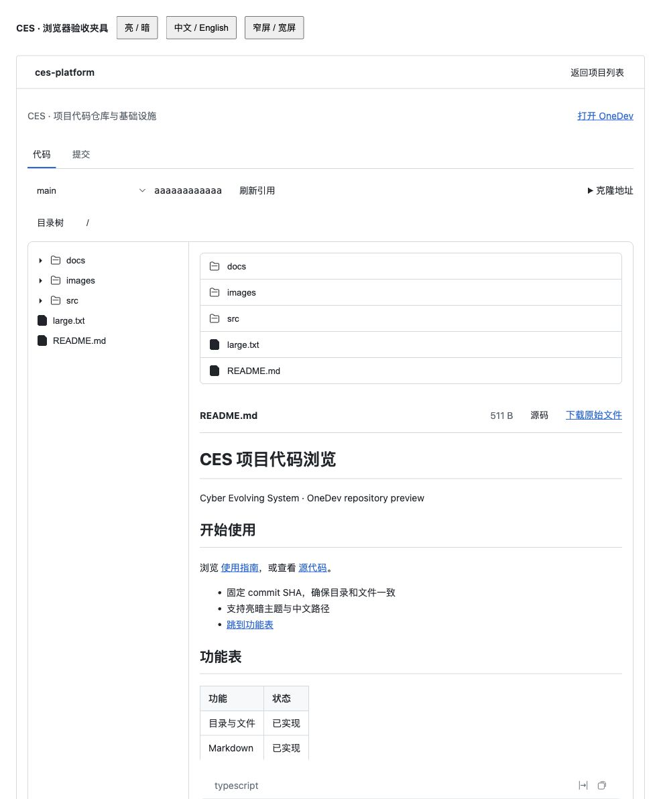
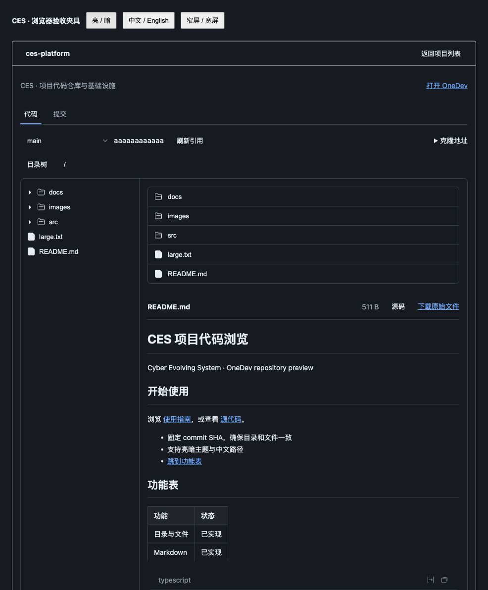

# 项目代码浏览 P1 验收记录

- 日期：2026-11-04
- 对应设计：[项目代码浏览 UI](../../design/project-code-browser/README.md)
- 交付范围：P1 与独立的已保存密码显示、隐藏、复制功能。
- 状态：本地实现与验收完成；未部署到现有 CES，未使用实际 OneDev 凭据联调。

## 实现

项目列表支持每批 100 项继续加载；仓库详情提供分支/Tag、按需目录树、文件高亮、当前目录 README、安全 Markdown、下载、克隆地址与最近 100 条提交。所有仓库内容固定到解析后的 commit SHA。hash 保存栏目、仓库、引用、SHA、路径与标签页，frame 恢复外层栏目。

Host 使用现有 CES 会话及加密凭据，校验上游结构、限制响应大小与耗时，并在断开或插件卸载时取消请求。文件预览保留原始大小和 partial 状态；图片验证格式，下载不返回截断内容。密码读取使用独立同源 JSON POST、no-store 和实例内限流，前端在 30 秒、隐藏或卸载时清除显示状态。

OneDev 默认分支端点按原始文本读取，包括未加引号的分支名和 204 空响应。普通 JSON 端点继续进行结构校验。克隆地址使用配置的公开地址，不返回内部认证信息。

## 自动验证

| 检查 | 结果 |
| --- | --- |
| `npm run test --workspace=@smp/console-project-repositories` | 17 项通过 |
| `npm run test --workspace=@smp/console-frame` | 41 项通过 |
| `npm run typecheck --workspace=@smp/console-project-repositories` | 通过，使用 dsh 0.2.1-rc.5 实际 UI 类型 |
| 两个受影响插件的 `npm run build --workspace=…` | 通过 |
| `git diff --check` | 通过 |

仓库测试覆盖认证与秘密不外泄、第二批项目、同名分支/Tag、原始默认分支、上游错误脱敏、SHA 固定、路径与下载边界、UTF-8/行数/二进制、Markdown 相对链接、超限响应取消、卸载中止与等待、旧 SHA 响应竞争，以及密码超时/页面隐藏/迟到响应清理。frame 回归包括新增的栏目 hash 状态测试。

## 浏览器验证

本地夹具加载本次 React 组件、console-kit 样式和实际 dsh UI primitives，并运行本次 Host 路由；OneDev 为本地 HTTP mock，使用虚构凭据。夹具不是完整 CES 宿主，不能替代真实部署联调。

已验证：

- 列表进入详情、返回列表、空仓库提示。
- README 渲染、嵌套文档、`../` 相对源码链接、受限仓库图片与外部图片链接。
- 同名分支和 Tag 解析到不同 SHA，代码高亮与行号正常。
- 中文、空格和 `#` 文件名，刷新恢复固定 SHA 与路径，浏览器后退恢复文件。
- 最近 100 条提交及更多记录提示。
- 中文/英文、亮色/暗色、430 px 窄屏与目录树折叠。
- 验证结束时浏览器错误日志为空。

以下截图来自夹具，项目与内容均为测试数据。

### 亮色

### 暗色

## 后续范围

真实 OneDev 16.9.7 部署仍需验证代理路径、认证、实际仓库数据及完整 CES 外壳的导航恢复。提交详情、Diff、文件历史和完整历史遍历属于 P2，本次未实现。未执行全仓库测试，仅验证受影响的两个插件。
