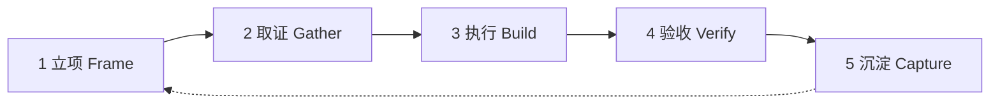

# 标准流程

一件事从想法到交付，固定走五个阶段。每个阶段有明确的输入、产出和退出条件；达不到退出条件，不进入下一阶段。

| 阶段 | 一句话 | 产出 | 退出条件 |
| --- | --- | --- | --- |
| 1 立项 | 把模糊需求变成可验收的产物定义 | 工作项记录 | 验收条件可被第三方检查 |
| 2 取证 | 收集事实，消除未知 | 事实清单、假设清单 | 未知项不再阻塞决策 |
| 3 执行 | 小步实现，随时可回滚 | 可运行的改动或草稿 | 每个子步骤都能独立验证 |
| 4 验收 | 用证据对照验收条件 | 验收记录 | 验收条件全部满足 |
| 5 沉淀 | 把可复用的部分固化 | 提示词、脚本、原则更新 | 下次同类问题可直接取用 |

## 1. 立项 Frame

**输入**：一个模糊的想法、一句需求、一个卡点。

**动作**
1. 用 `scripts/New-WorkItem.ps1` 建一条工作项。
2. 写「交付定义」：谁用、用来干什么、什么算完成。
3. 把「完成」翻译成 1–3 条可检查的验收条件。

**产出**：`work/<年>/<日期>-<slug>.md`，至少一条验收条件。

**退出条件**：另一个人只看文档，就能判断这件事做没做完。做不到，说明还缺信息，去取证。

**常见问题**：把「做完」写成「优化一下」「完善文档」。这类词无法验收，必须换成具体检查项。

## 2. 取证 Gather

**输入**：工作项记录。

**动作**
1. 把信息分成三类：已知、未知、假设。
2. 未知项逐条查证：读文件、跑命令、查文档，不靠记忆。
3. 查不了的写成「假设」，并标注验证方式。

**产出**：事实清单 + 假设清单。

**退出条件**：没有「不知道、但会影响方案」的项。

**原则**：取证阶段花掉的时间，通常在执行阶段加倍省回来。

## 3. 执行 Build

**输入**：验收条件 + 事实清单。

**动作**
1. 把工作拆成能在一次提交内完成的步骤。
2. 每步先想「怎么验证」，再动手。
3. 每步结束立即验证；失败就地修，不带着问题往前走。

**产出**：可运行的改动、草稿，或结论。

**退出条件**：每个子步骤都有对应的验证记录。

**原则**：一次只改一件事。改三处出问题，回滚和定位的代价是三倍。

## 4. 验收 Verify

**输入**：改动 + 验收条件。

**动作**
1. 逐条对照验收条件，记录证据：命令、输出、文件路径与行号。
2. 换个视角再过一遍：另一个 Agent 角色，或隔一天回看。
3. 不满足就回到执行阶段，不带「差不多」交付。

**产出**：验收记录表。

**退出条件**：全部验收条件通过，且证据可复现。

## 5. 沉淀 Capture

**输入**：验收记录 + 过程记录。

**动作**
1. 问三个问题：这次重复了什么？下次还会遇到吗？怎么让它更省事？
2. 能固化的落到对应位置：提示词进 `prompts/`，脚本进 `scripts/`，原则进 `docs/`。
3. 更新工作项状态与复盘。

**产出**：更新后的仓库资产。

**退出条件**：下次同类任务，能靠仓库里的东西起步，而不是从零开始。

## 时间盒参考

| 阶段 | 建议占比 | 提醒 |
| --- | --- | --- |
| 立项 | 10% | 超过 30 分钟还写不清验收条件，说明任务太大，先拆 |
| 取证 | 30% | 不要用「边做边查」代替取证 |
| 执行 | 40% | 单步超过一天，继续拆 |
| 验收 | 15% | 不许跳过 |
| 沉淀 | 5% | 宁可只写三行，也不要写完就忘 |

## 常见走偏

| 现象 | 根因 | 纠正 |
| --- | --- | --- |
| 做完发现方向不对 | 立项没写验收条件 | 回到立项，补交付定义 |
| 反复返工 | 取证不足，靠猜 | 补事实清单，逐条查证 |
| 改动越滚越大 | 一次改多件事 | 拆提交，回滚到上一个绿点 |
| 交付后没人用 | 验收条件与使用场景脱节 | 让使用者参与定义验收条件 |
| 同样的坑踩第二次 | 没有沉淀 | 把结论写进 `docs/` 或提示词 |
